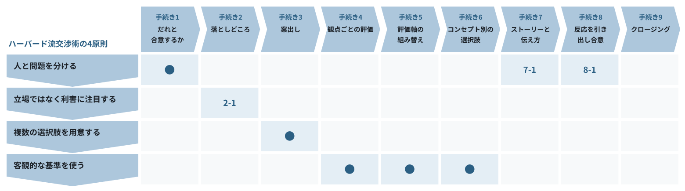
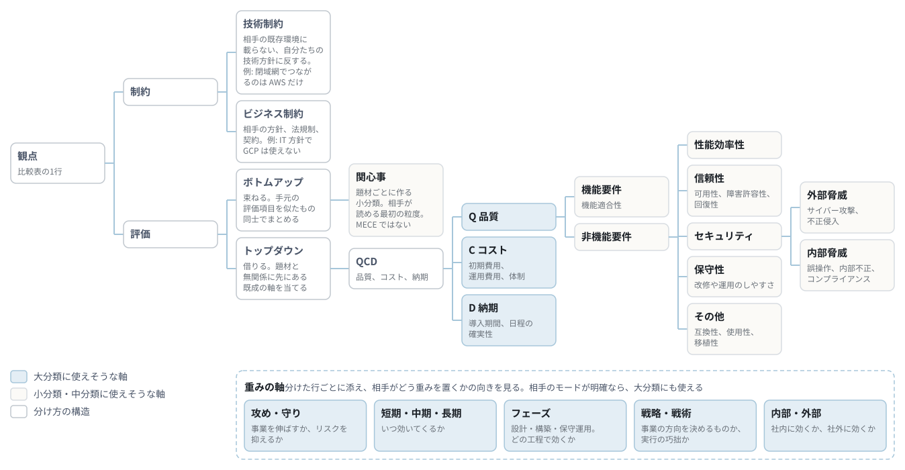
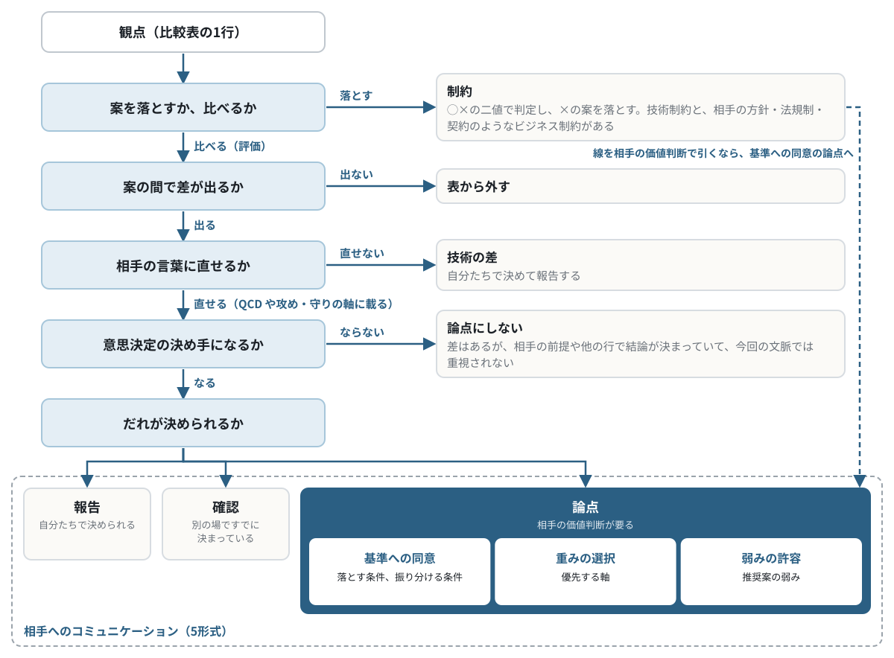
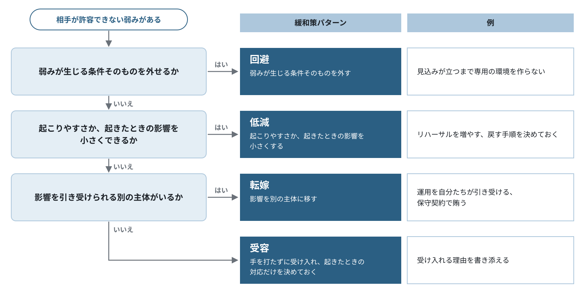

<!-- ケーススタディの相手向けの資料と、相手の発言の引用はですます調のため -->
<!-- textlint-disable ja-technical-writing/no-mix-dearu-desumasu -->

# Appendix

## 合意形成の手続き

### 一般的な合意形成術との関係

ハーバード流交渉術の4原則は、「人と問題を分ける」「立場ではなく利害に注目する」「複数の選択肢を用意する」「客観的な基準を使う」である。本書の手続きはこれを概ね踏襲しており、技術を相手の言葉に翻訳する手続きを追加している。

## 手続き4 各案を観点ごとに評価する

### 案の絞り込みパターン

洗い出した案を絞り込む理由は、制約、要件の未達、劣位に3分類できる。

| 分類       | パターン                    | 説明                                                                                                                                         | 絞り込む場合の相手への伝え方の例                                                                 |
| :--------- | :-------------------------- | :------------------------------------------------------------------------------------------------------------------------------------------- | :----------------------------------------------------------------------------------------------- |
| 制約       | 技術制約                    | 相手の既存環境に載らないもの、既存システムとつながらないもの、自分たちの技術方針（サポート終了が近い製品は採らない、など）に反するものを外す | 「今の閉域網でつながるのは AWS だけなので、ほかのクラウドは外します」                            |
|            | ビジネス制約                | IT 方針、法規制、契約に反するものを外す                                                                                                      | 「業界のガイドラインでデータを国内で保管する必要があるため、国内リージョンのない製品は外します」 |
| 要件の未達 | 機能要件                    | 今回の用途に要る機能（データ基盤なら、アクセス権限の管理やデータカタログ）を持たないものを外す                                               |                                                                                                  |
|            | 非機能要件 （性能・拡張性） | 今のデータ量や利用者数で基準を満たさないものと、増えたときに持ちこたえないものを外す                                                         |                                                                                                  |
|            | 非機能要件 （移植性）       | 用途が固まらない段階で、特定の技術にロックインされ、後から載せ替えにくいものを外す                                                           |                                                                                                  |
|            | 非機能要件 （保守性）       | 標準的な運用プロセスに乗らないもの、作り込みが要るもの、扱える人を確保しにくいものを外す                                                     |                                                                                                  |
| 劣位       | 下位互換                    | どの観点でも、ほかの候補と同等か劣るものを選択肢から外す                                                                                     |                                                                                                  |

## 手続き5 相手が判断できる評価軸に組み替える

### 評価軸に借りる既成の軸

システム構築のプロジェクトでは、大分類に QCD を借りると収まりがよい。Q の中身は ISO/IEC 25010 の品質特性を参考にできる。積み上げで作った評価軸だけだと、「なぜこの軸なのか」「観点に抜けはないか」と問われやすい。広く受け入れられた分類を起点にすれば、相手の納得を得やすく、自分たちも観点の抜けを防げる。

攻め・守りを大分類にするときは、性能や開発の速さを攻めの側、セキュリティや可用性を守りの側に振り分ける。相手が攻めと守りのどちらを重視するかで判断しようとしているときに使う。どの軸を借りるかは、相手に何を問いたいかで選ぶ。

## 手続き6 評価軸からコンセプト別の選択肢を作る

### 相手へのコミュニケーションは、5形式に分類できる

比較表の観点は、制約と評価に分かれる。同じセキュリティ項目でも、必須なら制約、充実度を比べるなら評価である。制約は案を候補から外すのに使う。外す条件そのものに相手の同意が要るときだけ、基準への同意として問う。評価は、案同士で差が出れば論点になり、優先度の選択か弱みの許容として問う。手続き6 のコンセプト別の選択肢は、このうち優先度の選択の形で問う。

形式ごとに、資料に必要な記載内容が異なる。

| 区分                        | 形式         | 相手に求めること                                                                       | 利用条件                                                               | 資料に必要な記載内容                                                                |
| :-------------------------- | :----------- | :------------------------------------------------------------------------------------- | :--------------------------------------------------------------------- | :---------------------------------------------------------------------------------- |
| 相手の価値判断が不要        | 報告         | 決めた内容を把握してもらう                                                             | 相手の価値判断は要らない。自分たちで決めた                             | 決めた内容と、その役割・採用理由、相手側の作業や運用への影響の有無                  |
|                             | 確認         | 想定が合っているかの確認                                                               | 相手から事実として回答がある。または別の場ですでに決まっている         | 自分たちの想定と、その根拠                                                          |
| 相手の価値判断が要る / 相談 | 基準への同意 | 案を落とす条件や、振り分ける条件に同意を得る。結果は条件から決まり、相手は何も諦めない | 候補が多く予選が要る。または、個別の判断をルールで束ねる               | 基準と、それを適用した結果 （→手続き4-1）                                           |
|                             | 優先度の選択 | 残った案のトレードオフのうち、何を優先し何を諦めるかを、推奨案を添えて合意する         | トレードオフの構造が出ていて、案ごとにどの重み付けなら選ぶかが言える。 | 推奨案と、コンセプト名を付けた案ごとのメリット・デメリット（→手続き6-3、手続き6-4） |
|                             | 弱みの許容   | 推奨案に残る弱みを、緩和策込みで許容できるか確認する                                   | 推奨案が1つに絞れていて、弱みが許容できる範囲に収まっている            | 弱みと緩和策の対 （→手続き8）                                                       |

比較表の行がいくら多くても、相手に判断を求めるのは論点に残った数行だけである。残りは報告か確認として、まとめて済ませることができる。

### コンセプト別の選択肢のパターン

評価軸のうち、片方を取るともう片方を諦めることになる組が、コンセプトの対になる。

| 分類                   | メリット                         | デメリット                             | 題材の例                       |
| :--------------------- | :------------------------------- | :------------------------------------- | :----------------------------- |
| 性能とコスト           | 応答が速く、操作の体感がよい     | 年間のコストが上がる                   | リージョン、インスタンス       |
| スピードと将来の拡張性 | すぐ使い始められる               | 後で載せ替えることになる               | PoC 先行の基盤                 |
|                        | スモールスタートできる           | 大規模になったときに複雑化しやすい     | サーバーレス、小さく始める構成 |
| 統制と自由度           | 全社の統制と調達に乗る           | 現場の開発生産性が下がる               | クラウド、開発ツール           |
|                        | 自社で統制できる                 | 手離れが悪い                           | マネージドかセルフか           |
| 安心感と先進性         | 事例が多く失敗しにくい           | 設計思想が古いまま残る                 | 製品、アーキテクチャ           |
| 汎用品と特注品         | 採用しやすく、外注先も見つかる   | 特定領域（データ、AI）の立ち上げが遅い | クラウドの選定                 |
|                        | 自前で組むので要件に合わせられる | 内製化して運用できる人が要る           | フレームワーク、OSS            |

## 手続き8 相手の反応を引き出し合意する

### 緩和策は、4つの型から考える

相手が弱みを許容できないときも、別の型の緩和策なら許容できることがある。

