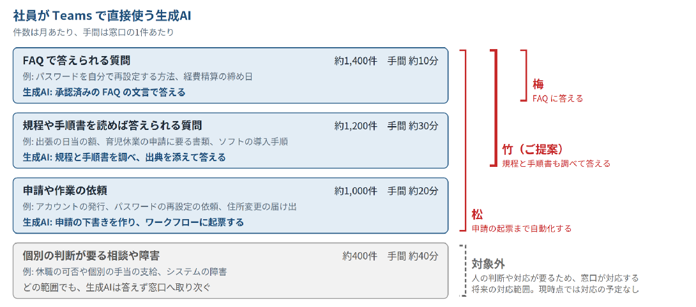
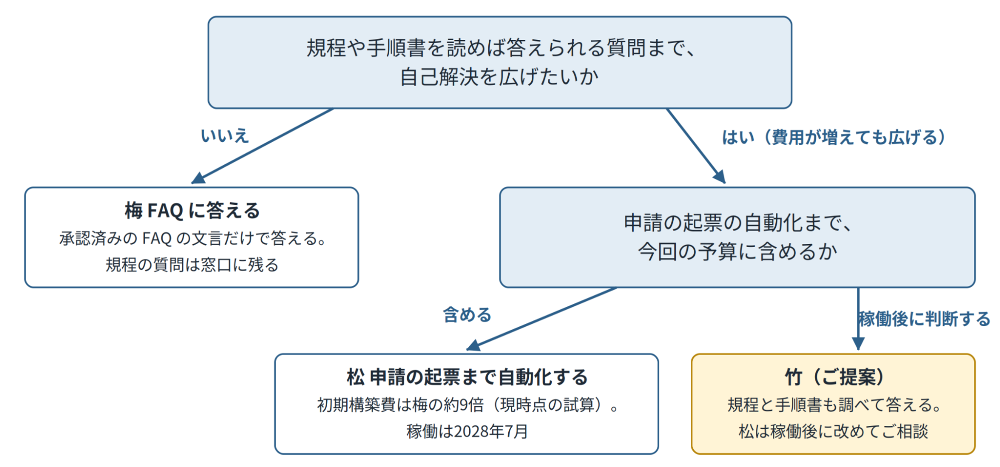
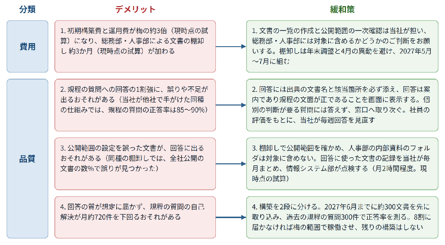

<!-- ケーススタディの相手向けの資料と、相手の発言の引用はですます調のため -->
<!-- textlint-disable ja-technical-writing/no-mix-dearu-desumasu -->

# ケーススタディ3: 社内問い合わせへの生成AIの導入範囲

## 題材の設定

- 相手: 国内の中堅の設備工事会社（電気・空調の設備工事。従業員約3,500人）。全国の支店と約300の作業所に社員が分散している。合意する先は、情報システム部で社内問い合わせの改善を担当する課長
- 自分たち: 相手の情報システム部から、社内問い合わせへの生成AIの導入を受託する予定の開発会社。構築と稼働後の運用保守を担う
- 現行: 情報システム部のヘルプデスク（外部委託を含む）と、総務部・人事部の窓口が、メール・電話・Teams で社内の問い合わせを受けている。件数は月約4,000件で、受付は平日9時〜18時。社内ポータルに FAQ 約400問があるが、探しにくく利用が少ない
- 計画: DX戦略で、社内問い合わせを生成AIで効率化することが決まっている。稼働は2027年10月を目標とする
- きっかけ: 来年度予算の申請が2027年1月中旬に締め切られる。範囲によって初期構築費が大きく変わるため、12月の定例で範囲を決めたい
- 決めたいこと: 生成AIで社内問い合わせのどこまでに対応するか
- 方針（同業で規模が近い2社の公開資料から借用）: 問い合わせ対応を生成AIで効率化し、窓口の工数と社員の待ち時間を減らす

## 社内問い合わせへの生成AIの導入範囲についてのご相談

### 背景

社内の問い合わせは、作業所の始業前や夜間に届くものが多く、受付時間外に届いた問い合わせの回答は翌営業日になっています。

### 相談事項

規程や手順書を読めば答えられる質問まで、社員が窓口を介さずに解決できるようにするか、広げる場合はどこまで広げるかを相談させてください。

対応する範囲によって初期構築費が大きく変わり、範囲を後から広げると稼働が1年遅れます。そのため、来年度予算の申請前の12月中に決まることが好ましいと考えています。

### 要件

- 業務要件
  - 社内問い合わせを生成AIで効率化する（DX戦略で決定済み）
  - 受付時間外の問い合わせにも答える
  - 作業所からもスマートフォンの Teams で問い合わせられる
- システム要件
  - 生成AIは、全社で利用している Microsoft 365 と Azure の契約の中で国内で動くものを使い、入力した内容を学習に使わせない
- その他
  - 来年度予算の申請は2027年1月中旬に締め切られ、年度の途中では予算を追加できない
  - 2027年10月に稼働する
  - 全社員への汎用の生成AIの展開は、全社の生成AI活用として別に検討しており、今回の範囲に含めない

### 構成案と推奨

社内問い合わせに生成AIで対応する範囲を、広い順に松・竹・梅の3段階で比べ、竹をご提案します。竹は、FAQ に加えて社内規程と手順書を調べて答えます。理由は次の2つです。

- 問い合わせの約4割に、受付時間外でもその場で答えられる。窓口の対応工数を月約500時間減らせる（梅は月約140時間）。差は、1件あたり約30分かかる規程の質問の分
- 申請の起票は後から追加でき、効果を稼働後の利用状況で確かめてから判断できる

窓口の直近6か月の記録を当社が分類すると、問い合わせは、答えるのに何が要るかで次の4つに分かれます。

費用の比と工数は、現時点の仮試算です。

【凡例】

- ✅ 問題がない、⚠️ 条件つきで対応できるか負担がある、❌ 事実上対応できない
- グレーの行: 3つの範囲で差が出ない観点

| 大分類 | 小分類       | 観点                                          | 松 申請の起票まで自動化する                                                                                                                                                | 竹 規程と手順書も調べて答える                                                                        | 梅 FAQ に答える                                                              |
| :----- | :----------- | :-------------------------------------------- | :------------------------------------------------------------------------------------------------------------------------------------------------------------------------- | :--------------------------------------------------------------------------------------------------- | :--------------------------------------------------------------------------- |
|        | 仕組み       | 生成AIが対応する範囲                          | 竹に加え、申請の下書きを作ってワークフローに起票する。パスワードの再設定とアカウントの発行は、本人を確かめたうえで自動で済ませる。その他の申請の処理は現行どおり窓口が担う | 梅に加え、全社員に公開している規程と手順書 約2,200文書から関係する箇所を探し、出典を添えて答える     | 承認済みの FAQ 約400問から答えを探して答える。FAQ に無い質問は窓口へ取り次ぐ |
| 品質   | 使いやすさ   | 自己解決できる問い合わせ                      | ✅ 月約2,260件、約6割                                                                                                                                                      | ✅ 月約1,560件、約4割                                                                                | ⚠️ 月約840件、全体の約2割                                                    |
|        |              | 受付時間外の問い合わせ（全体の約3割）への対応 | ✅ 申請の起票まで即時                                                                                                                                                      | ✅ 規程の質問まで即答                                                                                | ⚠️ FAQ の範囲だけ即答                                                        |
|        |              | 使う場所                                      | ✅ Teams（パソコン、スマートフォン）                                                                                                                                       | ✅ 同左                                                                                              | ✅ 同左                                                                      |
|        | 正確さ       | 回答の誤り                                    | ⚠️ 竹と同じ。申請の内容の誤りは、本人の確認と承認で止める                                                                                                                  | ⚠️ 規程の質問への回答の1割強に誤りや不足が出るおそれがある。出典を添え、社員が確かめられるようにする | ✅ 承認済みの FAQ の文言で答える                                             |
|        |              | 改定への追従                                  | ✅ 竹と同じ                                                                                                                                                                | ✅ 規程を差し替えれば回答に反映される                                                                | ⚠️ FAQ を人が直す                                                            |
|        | セキュリティ | 見せてはいけない文書が回答に出るおそれ        | ⚠️ 竹と同じ。加えて、生成AIにアカウントを操作する権限を与える                                                                                                              | ⚠️ 全社員に公開している文書に限る。公開範囲の設定を誤った文書があれば、回答に出るおそれがある        | ✅ FAQ だけを使う                                                            |
|        |              | 生成AIに与える権限                            | ⚠️ アカウントの操作を含む                                                                                                                                                  | ✅ 読み取りだけ                                                                                      | ✅ 読み取りだけ                                                              |
|        |              | 入力した内容の扱い                            | ✅ 国内の基盤で処理し、学習に使われない                                                                                                                                    | ✅ 同左                                                                                              | ✅ 同左                                                                      |
| 費用   | 初期費用     | 初期構築費                                    | ⚠️ 梅の約9倍（竹に加え、ワークフローとアカウント管理との連携）                                                                                                             | ⚠️ 梅の約3倍（文書の取り込み、関係する箇所を探して答える仕組み、回答の正しさの評価）                 | ✅ 基準                                                                      |
|        | 運用費       | 運用費（基盤の利用料と運用保守）              | ⚠️ 梅の約6倍                                                                                                                                                               | ⚠️ 梅の約3倍                                                                                         | ✅ 基準                                                                      |
|        |              | 基盤の利用料                                  | ⚠️ 年約600万円                                                                                                                                                             | ✅ 年約300万円                                                                                       | ✅ 年約100万円                                                               |
|        | 効果         | 減らせる窓口の対応工数                        | ✅ 月約620時間（申請は案内と差し戻しの手間 1件約10分を減らす）                                                                                                             | ✅ 月約500時間                                                                                       | ⚠️ 月約140時間                                                               |
|        | 貴社の作業   | 稼働までに貴社が担う作業                      | ⚠️ 竹に加えて、申請 約20種類の手順の整理と、ワークフローの改修の調整 約6か月                                                                                               | ⚠️ 梅に加えて、総務部・人事部による文書の棚卸し 約3か月                                              | ✅ FAQ の見直し 約1か月                                                      |
|        |              | 稼働後の窓口の運用                            | ⚠️ 取り次がれた問い合わせに対応                                                                                                                                            | ⚠️ 同左                                                                                              | ⚠️ 同左                                                                      |
| 納期   | 稼働時期     | 稼働時期                                      | ⚠️ 2028年7月                                                                                                                                                               | ⚠️ FAQ の部分は2027年7月、規程の部分は2027年10月                                                     | ✅ 2027年7月                                                                 |

竹の費用のうち、初期構築費と運用保守費は利用の多さによらずかかり、基盤の利用料 年約300万円は問い合わせの件数に比例します。減らせる工数は、FAQ で答えられる質問と規程の質問のそれぞれ約6割を、自己解決できる想定で算出しました（当社が他社で導入した同種の仕組みで、窓口への再度の問い合わせが無かった割合）。

範囲を広げるほど自己解決できる問い合わせが増え、費用と回答の誤りのおそれも増えます。規程の質問まで広げるかと、申請の起票の自動化まで今回の予算に含めるかで、選ぶ範囲が決まります。

以上から竹をご提案します。初期構築費と運用費が梅の約3倍（現時点の試算）になり、文書の棚卸し 約3か月（現時点の試算）が加わります。これらと引き換えに規程の質問まで自己解決を広げる、という方向について、まずはご所感を伺えますか。竹のデメリットと緩和策は、Appendix にまとめました。

### Appendix: 竹のデメリットと緩和策

竹には次の4つのデメリットがあり、それぞれに緩和策を講じます。

### Appendix: 竹で生成AIが答える質問と、窓口へ取り次ぐ質問

| 分類             | 区分                               | 竹での扱い                                                       |
| :--------------- | :--------------------------------- | :--------------------------------------------------------------- |
| 生成AIが答える   | FAQ で答えられる質問               | 生成AIが FAQ の文言で答える                                      |
|                  | 規程や手順書を読めば答えられる質問 | 生成AIが出典を添えて答える                                       |
| 生成AIが案内する | 申請や作業の依頼                   | 申請の手順と申請画面を案内する。手続きは現行どおり窓口が対応する |
| 窓口へ取り次ぐ   | 個別の判断が要る相談               | 答えず、総務部・人事部の窓口へ取り次ぐ                           |
|                  | 障害                               | 答えず、情報システム部のヘルプデスクへ取り次ぐ                   |
