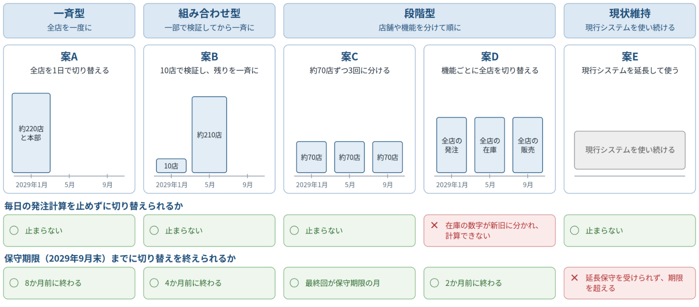
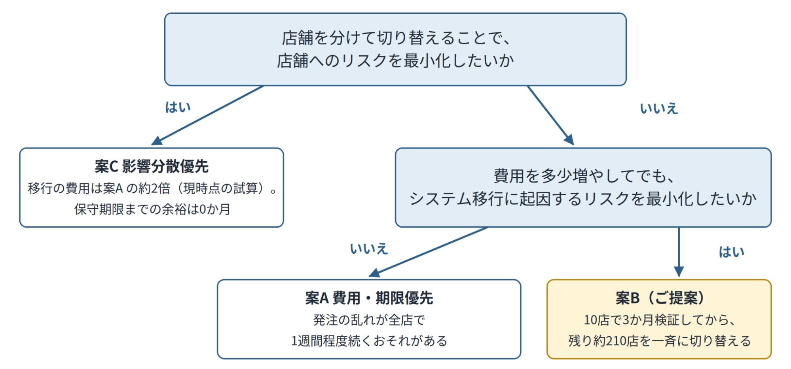
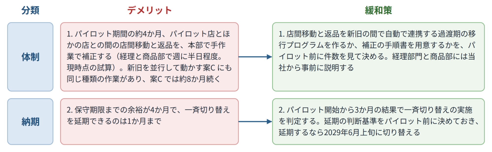
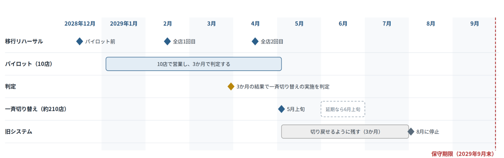

<!-- ケーススタディの相手向けの資料と、相手の発言の引用はですます調のため -->
<!-- textlint-disable ja-technical-writing/no-mix-dearu-desumasu -->

# ケーススタディ2: 基幹システム刷新の移行方式

## 題材の設定

- 相手: 国内の中堅食品スーパーチェーン。約220店舗を3エリア（各70店前後）で展開している。合意する先は、情報システム部で基幹システム刷新を担当する課長
- 自分たち: 基幹システム（販売・在庫・発注）刷新を受託した開発会社
- 現行: メインフレーム上の自社開発システム。ホストの保守期限は2029年9月末で、延長保守の可否は未確認
- 計画: 新システムはパッケージとクラウドで構築し、2027年4月から開発、2028年12月に総合テストを終える。移行リハーサルは、どの移行方式でも実施することで合意済み。新旧を並行して動かす期間は、新旧をつなぐ仕組みで足りない部分を本部が手作業で補う
- 決めたいこと: 移行方式。これが決まらないと、移行計画、移行リハーサルの回数、店舗の操作の練習の計画が引けず、2027年度の WBS を確定できない
- 方針（同業で規模が近い2社の公開資料から借用）: 自動発注を広げ、廃棄と欠品を減らす

## 基幹システムの移行方式についてのご相談

### 背景

基幹システムは毎日の自動発注につながっており、切り替えで不具合が出ると、店舗の欠品と廃棄に繋がる懸念があります。

### 相談事項

システムの切り替えで店舗に及ぶ影響を抑えることと、移行の費用を抑えて保守期限までの余裕を残すことの、バランスを取る必要があります。どの移行方式を選ぶかを相談させてください。

新旧のシステムをつなぐ仕組みは移行方式で開発量が大きく変わり、開発の初期から作り始めます。方式を後から変えるほど作り直しが大きくなるため、システム構築を担う当社としては、2027年度の作業計画を固める前の、今月中に決まることが好ましいと考えています。

### 要件

- 業務要件
  - 毎日の発注計算（販売の実績から在庫を、在庫から翌日の自動発注を計算する）を止めない
  - 切り替えは閉店後から翌朝の開店までに済ませ、営業を止めない
  - 年末とお盆の前後は切り替えない
- システム要件
  - 保守期限までに切り替えを終える（ホストの保守期限は2029年9月末で、延長保守は見込まない）
- その他
  - 新システムは2028年12月に総合テストを終える
  - 一斉に切り替える場合は、前後1か月ずつ出店と改装の開業を止められる

### 構成案と推奨

10店で先に3か月検証してから、残り約210店を一斉に切り替える、実店舗検証優先の案B をご提案します。理由は次の2つです。

- 発注の数量がずれる不具合は気づくまで続き、全店の欠品と廃棄に繋がる懸念がある。パイロット（先に10店だけを切り替え、実際の営業で検証すること）で先に見つけて直せば、全店での発注の乱れを1週間程度から1〜2日に抑えられると見込む
- 1回の影響を約70店に抑える案C に比べ、移行の費用は約3分の2（現時点の試算）で済み、保守期限まで4か月の余裕が残る（案C は最終回が保守期限の月にあたる）。レジや発注が止まる不具合は、旧システムへ切り戻せば最大3日程度で収まるため、案C の費用と期限のリスクを負ってまで約70店に抑える必要は小さいと考える

移行方式は、一斉型、組み合わせ型、段階型に分かれます。現行システムを使い続ける現状維持もあわせて、次の5つの案を考えました。

案D は、機能の途中で新旧が分かれると在庫の数字が2か所に分かれ、毎日の発注計算を止めてしまうため、採用できません。案E は、延長保守を受けられず保守期限を超えるため、採用できません。

残った3案を比べます。移行リハーサルは、本番と同じ手順とデータで行う切り替えの予行演習です。移行の費用は、いずれも移行の期間だけにかかります。費用の比と工数は、現時点の仮試算です。

【凡例】

- ✅ 問題がない、⚠️ 条件つきで対応できるか負担がある、❌ 事実上対応できない
- グレーの行: 3案で差が出ない観点

|            |                            | 一斉型                                                                       | 組み合わせ型                                                                                                    | 段階型                                                                                                         |
| :--------- | :------------------------- | :--------------------------------------------------------------------------- | :-------------------------------------------------------------------------------------------------------------- | :------------------------------------------------------------------------------------------------------------- |
| **大分類** | **小分類**                 | **案A 費用・期限優先**                                                       | **案B 実店舗検証優先**                                                                                          | **案C 影響分散優先**                                                                                           |
|            | 切り替えの進め方           | 約220店と本部を1日で切り替える（2029年1月）                                  | 10店を先に切り替えて約4か月営業し、最初の3か月の結果で判定して、残り約210店を一斉に切り替える（2029年1月、5月） | 3エリアを約70店ずつ、4か月おき（各回、3か月の検証と1か月の判定と準備）に3回で切り替える（2029年1月、5月、9月） |
|            | 新旧をつなぐ仕組み         | 不要                                                                         | 商品の情報を新システムへ、売上と在庫を本部会計へ、一方通行で送る                                                | 商品、発注、在庫、売上を新旧で常に一致させる                                                                   |
| 品質       | 営業への影響               | ⚠️ 不具合が出たとき、約220店のレジと発注に影響が及びうる                     | ⚠️ パイロット時は10店、一斉時は約210店                                                                          | ✅ 1回あたり約70店                                                                                             |
|            | 実店舗での検証             | ❌ できない。リハーサルだけで切り替える                                      | ✅ 10店の営業で3か月検証してから広げる                                                                          | ✅ 1回目の約70店で3か月検証してから広げる                                                                      |
|            | 旧システムへ切り戻せる範囲 | ⚠️ 全店単位でしか切り戻せない                                                | ⚠️ パイロット時は10店だけ切り戻せる。一斉時は全店単位                                                           | ✅ 約70店単位で切り戻せる                                                                                      |
|            | 本部の二重作業             | ✅ なし                                                                      | ⚠️ 約4か月、パイロット店とほかの店との間の店間移動と返品を、本部で手作業で補正する                              | ⚠️ 約8か月、商品部が新旧の両方で商品を登録し、発注を確認する                                                   |
|            | 店舗の教育                 | どの案も、全店で同じ量。操作マニュアルと練習用の環境で、切り替え前に練習する |                                                                                                                 |                                                                                                                |
|            | 新システムの機能           | どの案も同じ                                                                 |                                                                                                                 |                                                                                                                |
|            | データ移行の方法           | どの案も、切り替え前に全データを移し、当日はその後の変更分だけを移す         |                                                                                                                 |                                                                                                                |
| 費用       | 移行の費用                 | ✅ 基準                                                                      | ⚠️ 案A の約1.3倍（新旧をつなぐ仕組みの開発、移行リハーサル1回の追加、約4か月の運用支援）                        | ⚠️ 案A の約2倍（新旧を常に一致させる仕組みの開発、移行リハーサル3回の追加、約8か月の運用支援）                 |
|            | 移行後の運用費             | どの案も同じ                                                                 |                                                                                                                 |                                                                                                                |
| 納期       | 保守期限までの余裕         | ✅ 8か月                                                                     | ⚠️ 4か月。一斉切り替えを1か月延期できる                                                                         | ⚠️ 0か月。最終回が保守期限の月                                                                                 |
|            | 移行リハーサルの回数       | 2回                                                                          | 3回（パイロット前1回、一斉前2回）                                                                               | 5回（各回1〜2回）                                                                                              |
|            | 出店と改装の停止           | ✅ 全社で2か月                                                               | ✅ 全社で2か月。パイロットの前後は10店の改装だけ止める                                                          | ⚠️ エリアごとに2か月、全社でのべ6か月                                                                          |

残った3案は、店舗を分けて切り替えることで店舗へのリスクを最小化したいかと、費用を多少増やしてでもシステム移行に起因するリスクを最小化したいかで選び分けます。

以上から案B をご提案します。移行の費用を増やし保守期限までの余裕をなくしてでも、店舗を分けて切り替えて店舗へのリスクを最小化するなら、案C になります。一斉切り替えとする案B について、まずはご所感を伺えますか。案B のデメリットと緩和策は、Appendix にまとめました。

### Appendix: 案B のデメリットと緩和策

10店で3か月検証してから広げられ、移行の費用は案C の約3分の2（現時点の試算）で済み、保期限まで4か月の余裕が残ります。一方で次の2つのデメリットがあり、それぞれに緩和策を講じます。

### Appendix: 案B の日程

切り替えは、月次の締めが新旧にまたがらないよう、月初の閑散日に実施します。パイロットは、年始の繁忙が明けた後に始めます。

