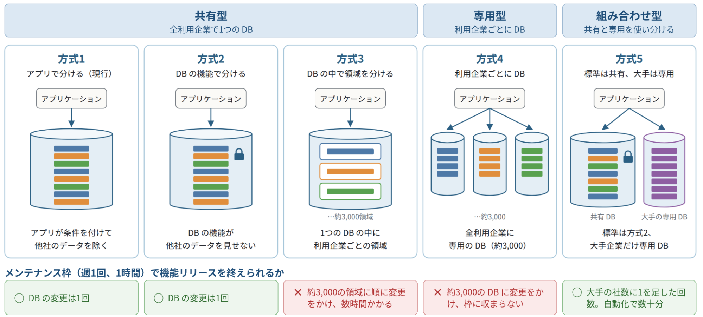
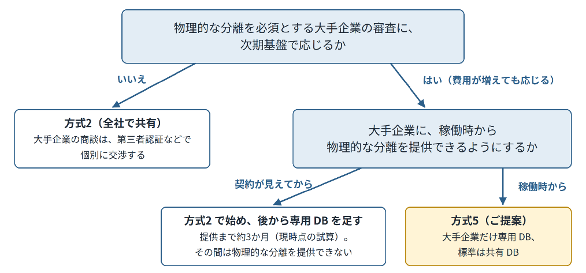
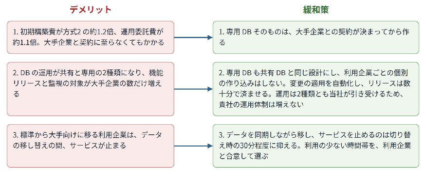

<!-- ケーススタディの相手向けの資料と、相手の発言の引用はですます調のため -->
<!-- textlint-disable ja-technical-writing/no-mix-dearu-desumasu -->

# ケーススタディ1: マルチテナントのデータ分離方式

## 題材の設定

- 相手: 国内の中堅 BtoB SaaS 事業者。人事・勤怠系の SaaS を約3,000社に提供しており、利用企業の大半は中小企業。合意する先はプロダクト責任者
- 自分たち: 次期基盤（AWS、Aurora PostgreSQL）の設計と、稼働後の運用保守を受託した開発会社
- 現行: 1つの PostgreSQL に全利用企業のデータを格納し、アプリケーションが tenant_id の条件を付けて読み書きしている
- 計画: 年明けからデータ層の詳細設計に入り、2028年4月に稼働する
- きっかけ: ここ1年で従業員1万人を超える大手企業との商談が増えたが、セキュリティチェックシートで他社データとの分離方式を問われ、保留や失注が出ている。チェックシートに回答できるよう、次期基盤でデータの分離を強めることは事業部として決まっている
- 決めたいこと: データの分離の方式。これが決まらないと、データ層の詳細設計を始められない
- 方針（同業で規模が近い SaaS 企業の公開方針から借用）: 大手企業の獲得

## 次期基盤における利用企業データの分け方についてのご相談

### 背景

大手企業との商談で、セキュリティ要求に対応できず、保留や失注になる例が出ています。物理的な分離を必須とするお客様もいらっしゃいます。

### 相談事項

次期基盤で、物理的な分離を必須とする大手企業の審査に応じるかどうかと、応じる場合は構成案がいくつかあるため、どれを選ぶかを相談させてください。

データの分け方で DB の構成が変わり、稼働後に専用 DB を足すと作り直しに2名で約3か月（現時点の試算）かかります。そのため、システム構築を担う当社としては、年明けからの DB の詳細設計に入る前の、12月中に決まることが好ましいと考えています。

### 要件

- 業務要件
  - 大手企業のセキュリティチェックシートの3つの設問（他社のデータと物理的に分離されているか、自社のデータだけを指定した時点に戻せるか、自社専用の暗号鍵を使えるか）に回答できる
  - 他社のデータとの分離を、現行のアプリケーションでの絞り込みより強化する
  - 機能リリースは、利用企業と約束している夜間のメンテナンス枠（週1回、1時間）の中で終える
- システム要件
  - 次期基盤は AWS の Aurora PostgreSQL で構築する
- その他
  - DB の詳細設計は年明けから始める
  - 2028年4月に稼働する
  - 稼働後の運用保守は当社が担う

### 構成案と推奨

物理的な分離を求める大手企業だけを専用の DB に分ける方式5 をご提案します。それ以外の利用企業（以下、標準）は共有 DB のまま、DB の機能で他社のデータを読めないようにします。理由は次の3つです。

- チェックシートで回答できずにいた3つの設問のすべてに、大手企業向けに回答できるようになる。止まっている商談を進められる。稼働前の商談でも、稼働後は専用 DB で分離すると回答できる
- 大手企業の負荷は専用 DB の中で収まり、標準の利用企業の応答も守れる
- 専用 DB を大手企業の分に絞るので、機能リリースはメンテナンス枠に収まり、基盤費も大手企業の社数分で済む

5つの方式は、全利用企業で1つの DB を共有する共有型（方式1〜3）、利用企業ごとに DB を分ける専用型（方式4）、共有型と専用型を使い分ける組み合わせ型（方式5）の3つの型に分かれます。
物理的な分離は、他社と DB そのものを分けることを指します。同じ DB の中で他社のデータを読めないように制御するものは論理的な分離と呼ばれ、物理的な分離を必須とする審査では認められません。

図の色は利用企業を、錠のマークは DB の機能で他社のデータを読めないようにしていることを表します。暗号鍵の意味ではありません。

方式3 と方式4 は、機能リリースのたびに約3,000か所へ変更をかけるため、メンテナンス枠（週1回、1時間）に収まらず、採用できません。残った方式2 と方式5 を、現行の方式1 と比べます。費用の比と工数は、現時点の仮試算です。

【凡例】

- ✅ 問題がない、⚠️ 条件つきで対応できるか負担がある、❌ 事実上対応できない
- グレーの行: 3つの方式で差が出ない観点
- 大手: 物理的な分離を求める大手企業

|        |                |                              | 共有型                                                                                                      |                                                                                       | 組み合わせ型                                                                             |
| :----- | :------------- | :--------------------------- | ----------------------------------------------------------------------------------------------------------- | :------------------------------------------------------------------------------------ | ---------------------------------------------------------------------------------------- |
| 大分類 | 小分類         | 観点                         | 方式1 アプリで分ける（現行）                                                                                | 方式2 DB の機能で分ける                                                               | 方式5 標準は共有、大手は専用                                                             |
|        | 仕組み         | 分離手段                     | 全利用企業のデータを1つの DB に格納し、アプリケーションが読み書きのたびに自社のデータだけに絞る。現行の方式 | 1つの DB を共有するが、DB の機能で他社のデータを読めないようにする                    | 標準の利用企業は方式2、物理的な分離を求める大手企業だけ方式4                             |
|        |                | 実現手段                     | アプリケーションが利用企業の識別番号で絞る                                                                  | DB の機能で他社のデータを読めないようにする（PostgreSQL の行レベルセキュリティ）      | 標準は方式2、大手は方式4                                                                 |
| 品質   | セキュリティ   | 他社のデータの遮断           | ❌ アプリケーションの作りに頼る                                                                             | ✅ DB の機能で遮断                                                                    | ✅ 大手は DB そのもの、標準は DB の機能                                                  |
|        |                | 大手企業の審査: 物理的な分離 | ❌ DB では分離していない                                                                                    | ⚠️ 論理的な分離。物理的な分離を必須とする審査は通らず、第三者認証などで個別に交渉する | ✅ 大手企業は物理的に分離。標準は方式2 と同じ                                            |
|        |                | 大手企業の審査: 専用の暗号鍵 | ❌ 使えない                                                                                                 | ❌ 使えない                                                                           | ✅ 大手企業は使える                                                                      |
|        | 信頼性         | 1社の負荷が他社に及ばないか  | ⚠️ 大手1社の月末の集計などが、全利用企業の応答を遅くしうる                                                  | ⚠️ 同左                                                                               | ✅ 大手の負荷は専用 DB の中で収まり、標準の利用企業にも及ばない                          |
|        | 保守性         | 1社分のデータを戻す時間      | ⚠️ 1営業日以内                                                                                              | ⚠️ 1営業日以内                                                                        | ✅ 大手企業は30分程度。標準は1営業日以内                                                 |
|        |                | 運用する対象の数             | ✅ DB 1つ                                                                                                   | ✅ DB 1つ                                                                             | ⚠️ 共有 DB 1つと大手の数                                                                 |
| 費用   | 初期費用       | 初期構築費                   | ✅ 追加なし                                                                                                 | ✅ 追加なし                                                                           | ⚠️ 方式2 の約1.2倍（専用 DB を自動で用意し更新する仕組みの構築が加わる）。社数によらない |
|        |                | アプリケーションの改修       | ⚠️ 利用企業を識別する仕組みの改修                                                                           | ⚠️ 同左                                                                               | ⚠️ 同左                                                                                  |
|        |                | データの移行                 | ⚠️ 現行から全件を移す                                                                                       | ⚠️ 同左                                                                               | ⚠️ 同左                                                                                  |
|        | 運用費         | 運用委託費                   | ✅ 現行どおり                                                                                               | ✅ 現行どおり                                                                         | ⚠️ 方式2 の約1.1倍。社数によらない                                                       |
|        |                | 月々の基盤費                 | ✅ 現行と同程度                                                                                             | ✅ 現行と同程度                                                                       | ⚠️ 大手1社あたり月約10万円                                                               |
| 納期   | リリースの速さ | 機能リリース時の DB 変更     | ✅ 1回                                                                                                      | ✅ 1回                                                                                | ⚠️ 大手の社数に1を足した回数。自動化により数十分で、メンテナンス枠に収まる               |

残った方式2 と方式5 の違いは、大手企業の扱いだけです。物理的な分離を必須とする審査に応じるかどうかと、稼働時から提供するかで、選ぶ方式が決まります。

以上から方式5 をご提案します。構築と運用の費用が増えても、物理的な分離を必須とする大手企業の審査に応じる、という方向について、まずはご所感を伺えますか。方式5 のデメリットと緩和策は、Appendix にまとめました。

### Appendix: 方式5 のデメリットと緩和策

物理的な分離を必須とする審査を通せ、大手企業ごとに性能、復元、暗号鍵を個別に保証できます。一方で次の3つのデメリットがあり、それぞれに緩和策を講じます。

