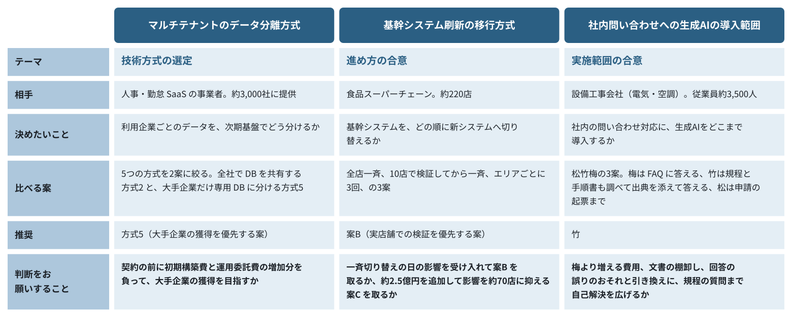

<!-- ケーススタディの相手向けの資料と、相手の発言の引用はですます調のため -->
<!-- textlint-disable ja-technical-writing/no-mix-dearu-desumasu -->

# ケーススタディ

手続き1〜7 で作成した、相手向けの合意形成資料のサンプルを3つ作成した。

1. [マルチテナントのデータ分離方式](./case_multitenant.md): 技術方式の選定。5つの方式を2案に絞り、物理的な分離を必須とする大手企業の審査に、費用を負って応えるかを問う
2. [基幹システム刷新の移行方式](./case_migration.md): 進め方の合意。1回の切り替えで影響を受ける店舗数を抑える必要があるかを問う
3. [社内問い合わせへの生成AIの導入範囲](./case_genai.md): 実施範囲の合意。松竹梅の3案で、規定の質問まで自己解決を広げるかを問う

失敗例は、[失敗パターンと処方箋](./failure_patterns.md)に、相手の反応ごとに載せている。
