<!-- ケーススタディの相手向けの資料と、相手の発言の引用はですます調のため -->
<!-- textlint-disable ja-technical-writing/no-mix-dearu-desumasu -->

# ソフトスキルガイドライン 合意形成編

本書は、プロジェクト推進のために解決すべき検討テーマを相手と円滑に議論し、合意形成へ導くための手続きをまとめたものである。[ソフトスキルガイドライン](../softskill_guidelines.md)の（4）説明力のうち、合意形成を詳しく扱った派生編にあたる。

位置づけ・免責事項は [ソフトスキルガイドラインの Introduction](../index.md) を参照。

## はじめに

資料を準備してたくさん話したのに、伝わらない、決まらない。たとえば次のような場面である。

- 目的や文脈を話さず詳細説明に入り「これ何の時間？」
- 比較表の特徴は説明したが「で？」
- 「技術的には A の方式が優れています。これで良いでしょうか？」と技術の優劣だけで押して、ハレーション

言い方の問題に見えるが、ベテランが暗黙のうちに押さえている勘所が抜けている場合がある。その思考の流れを9つの手続きに分解して示す。

### 想定読者

合意形成に悩むメンバーと、そのレビュアー。メンバーはセルフレビューに、レビュアーはメンバーがどこで躓いているかの特定に使える。

なお、検討テーマ自体を決めるためのタスクの分解術や、純粋な技術のあるべき論を考えるプロセスは、本書のスコープ外とする。

## 合意形成とは何か

合意形成とは、立ち位置や知識量の異なる相手と自分たちが、見えているものや重視するもののずれをすり合わせ、根拠に基づいて一致した結論を出すことである。相手を言い負かすディベートではない。

本書の手続きは、相手の価値判断を確かめて案を選ぶ場面にも、自分たちが推す案の理由を伝える場面にも使える。

## 合意形成の構造

決めたいことには複数の選択肢があり、それぞれにメリット・デメリットがある。何を優先し、どのリスクを許容するかを相手と揃えておかないと、後で手戻りになる。自分たちが決めたいのは技術方針だが、その一段上には、それを左右する相手の価値判断がある。相手と合意するのはこの価値判断であり、それが決まれば技術方針が決まるように組み立てる。

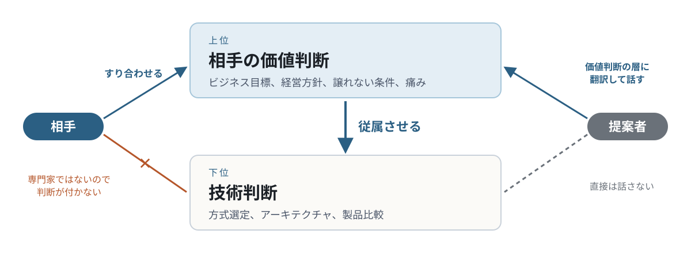

技術的な特性のまますり合わせようとすると、打合せがITの勉強会になり、時間を浪費する。

DWH の製品を決めたいとする。その一段上には、内製化のしやすさ、運用の手離れ、既存資産との親和性のうち何を優先するか、という相手の価値判断がある。内製化と Google アカウント連携を優先するなら BigQuery、運用の手離れを優先するなら Snowflake、既存の AWS 資産との親和性を優先するなら Redshift になる。「◯◯が決まれば、今回決めたいことが決まる」の◯◯を探し、その◯◯を決めるための論点を作る。

## 心構え

心構えを、自分たちと相手、結論と根拠の4つに分けて示す。
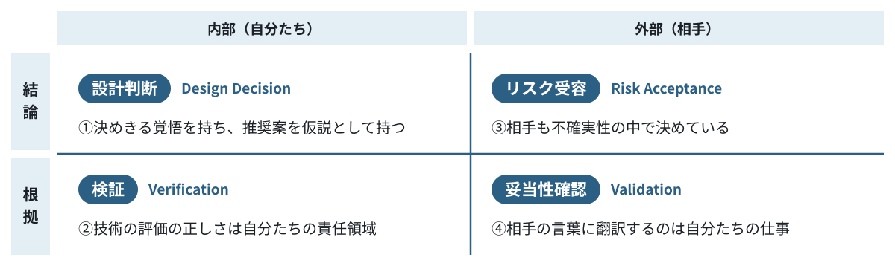

_列は自分たちと相手、行は結論と根拠で分けた。根拠の行は、ソフトウェア工学の V&V（Verification: 正しく作っているか、Validation: 正しいものを作っているか）に対応する_

1. **決めきる覚悟を持ち、推奨案を仮説として持つ**
   だれかが決めてくれるとは思わない。一歩引いた評論家ではなく実務家として、自分ならどれを、何を理由に選ぶかを決める。どう着地させるかの道筋を、常に自分で持っておく。
2. **技術の評価の正しさは自分たちの責任領域**
   技術の評価は客観的かつ誠実に行う。◯△×が正しいかを相手に確かめてもらわない。なぜその評価になったかを、自分たちで説明できるようにしておく。
3. **相手も不確実性の中で決めている**
   相手も、判断を誤れば立つ瀬が無く、上への調整も抱えている。整理したのに決断してくれないという他責の姿勢では進まない。同じミッションに向かう仲間として敬意を払い、どこに引っかかるかを引き出す。
4. **相手の言葉に翻訳するのは自分たちの仕事**
   技術そのものを分かってもらおうとせず、相手の価値判断の言葉に置き換える。自分が相手の立場なら、この内容で判断できるかを自問する。

## 合意形成の手続き

全体像を示す。

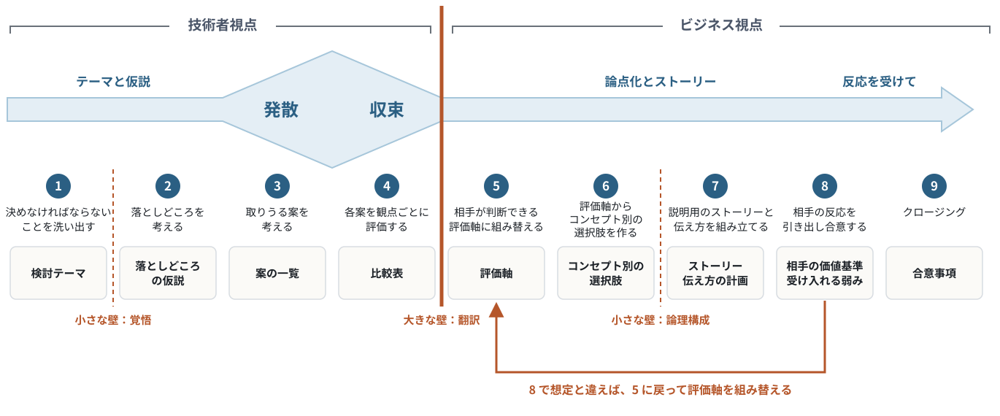

手続き4 までは技術者の視点で進められる。手続き5 からは相手の目線に切り替えるため躓きやすく、レビュアーのフォローが要る。

検討テーマが変わっても順序は同じで、どの手続きが重くなるかが変わる（製品選定なら手続き4 の絞り込み、処理方式の検討なら手続き5 の組み替え）。

## 手続き1 決めなければならないことを洗い出す

未決事項を洗い出し、何をだれと合意するかを決める。

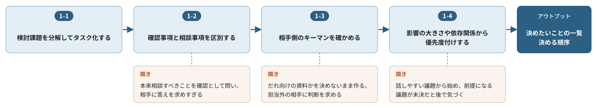

- （1-2）確認事項は、海外拠点の有無のように、相手から事実として答えが返ってくるものである。相談事項は相手の価値判断が要るもので、セットで推奨案を添える
- （1-3）資料がだれ向けかが決まっていないと、説明の筋が妥当かを判断できない。相手は相手側の担当者と統括のように多段階のことも、論点ごとに答えられる人が違うこともある（待ち時間の許容は業務部門、操作記録の要否は監査やセキュリティの部門など）。分からなければレビュアーに相談するか、仮説を添えて相手に確かめる
- （1-4）優先度は、タスク同士の依存関係、リードタイム、決定を後から戻せるかで決める。全体量と優先度を先に合意しておくと、個別の打合せで、なぜ今この話をするのかを説明でき、ハレーションが生じにくい

::: info 在庫連携の例

ここから各手続きに、ECサイトと基幹システムの在庫連携の方式を決める例を添える。現状は夜間の一括連携のため、日中に売り越しが続いている。確認事項は、基幹システムに在庫を返す API があるか、改修を頼める時期はいつか。相談事項は、在庫数がどれだけ遅れて見えてよいか。相談事項はEC事業部の責任者に、確認事項は情報システム部門に持っていく。

:::

## 手続き2 落としどころを考える

相手の判断基準（相手が何を重く見て決めるか）に当たりをつけ、落としどころとなる推し案（仮説の段階の推奨案）を作る。この段階で作るのは、後続の調査や比較に際限なく時間を使うのを防ぐためである。

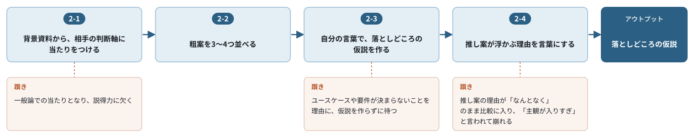

- （2-1）～（2-2）提案書、契約、過去の議事などを AI に読み込ませて、プロジェクト固有の背景知識を抽出させる。そして、コスト、スピード、セキュリティなどのどれを優先しそうかを見立て、粗案まで出しておく。見立てに自信が持てないときは、作成途中で相手に見せて確かめる（→ベテランの視点の、ジャブで関心事を引き出す）
- （2-3）推し案の仮説は外れてよい。仮説を否定されれば、判断基準の見立てのどこがずれていたかが明確になり、次善案の精度が高まる
- （2-4）推奨理由は、社内事例、相手が打合せで漏らした言葉、製品の勢いといった直感が出どころでもよい。直感が正しかったかは、案を評価するときに確かめる

::: info 在庫連携の例

相手はリリース時期と基幹の改修費を重く見ると見立て、15分ごとの差分ファイル連携を推し案にする。基幹側の改修が小さく、売り越しは取り寄せで吸収できると読む。

:::

## 手続き3 取りうる案を考える

論点は案同士を比較した差から生まれるので、案が1つでは先に進めない。比べた案が多いほど、残った案を選んだ根拠が強くなり自信が持てる。詳しくない領域では、AI にできるだけ多く案を出してもらう。

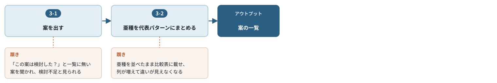

- （3-1）案出しのテクニック
  - 代替案が思いつかないときは、現状維持を1つの案として並べる
  - 実施スコープを決める題材では、松竹梅の3案を作り、推奨を竹とする。相手は範囲とコストを天秤にかけて選べばよいので、判断しやすい
  - SaaS かフルスクラッチかのような二者択一では、ハイブリッドも案に加える。ハイブリッドにも濃淡があるので、濃淡ごとに亜種として出しておく
- （3-2）似た案は、どの観点で違うかを見て代表パターンにまとめ、代表の下に添える。絞るのではなく整理する段階である。整理すると、パターンの空白から別の案が見つかることもある

::: info 在庫連携の例

夜間の一括ファイル連携（現状維持）、15分ごとの差分ファイル連携、注文のたびに基幹の API で在庫を引き当てる、在庫の変更をイベントで送る、基幹の DB を直接参照する、の5案を挙げる。

:::

::: info （3-1）実質的に1つしか案がない場合

計画策定時のスケジュールのように、スコープが固まれば最善の案が1つに決まる題材もある。実現できない案を並べる必要はない。案に付く前提（◯◯の調達が1か月以内に済む）と制約（移行リハーサルは全3回、追加は最大1回）を列挙し、それを受け入れるかを相手と合意する。

:::

## 手続き4 各案を観点ごとに評価する

案の一覧を技術者視点で比較し、どの観点で差が出るかを確かめる。ここでどのようなトレードオフの構造になるか大まかに掴む。

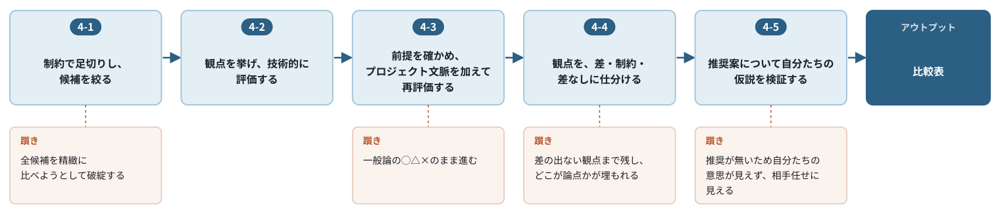

- （4-1）どの制約で案を落としたか、なぜその候補を挙げたか（市場でのデファクトスタンダード、相手の既存資産との親和性、自社の得意領域など）を説明できるようにする（→Appendixの、案の絞り込みパターン）
- （4-2）比較表は案を列に、観点を行にする。観点の方が増減しやすいためである。Pro/Con 形式は同じ観点で比べにくいので使わない
- （4-3）プロジェクトミッション、ユースケース、体制などを照らし合わせると、一般論の差が消えたり残ったりする。精度を上げるのは後回しでよい。足りない前提は仮に決め、そのことを比較表に明示する
- （4-4）文脈を加えて初めて制約になった観点があれば、それを満たさない案を外す。どの観点でもほかの案に劣る案も外す。ほかの候補が消え一択になった場合は、問いを作る材料がないので、相手には結果を報告として伝える
- （4-5）推奨案は、比較表の◯の数では決まらない。どの行を重く見たかが推奨の理由になるので、それを一言で書いておく

::: info 在庫連携の例

データの鮮度、基幹側の改修量、障害が波及する範囲、再送の仕組みで比べる。DB の直接参照は基幹の保守契約で禁止されているので、イベント連携は基幹のパッケージが変更の通知を出せないので外す。夜間一括は、日中の売り越しが今回のきっかけなので外す。残るのは差分ファイル連携と API の2案で、差は鮮度と改修量に出る。

:::

::: info （4-1）絞り込んだ理由の残し方

技術的な目利きで落とした案は、自分たちの判断として一言で足りる。相手側の制約で落とした案は、「IT 方針で使えるクラウドが限られるため」のように、どの制約で落ちたかを書く。相手が自分の前提と照らして、誤りに気づけるようにするためである。絞り込んで外した案まで比較表に並べる必要はない。

:::

::: info （4-3）機能では差が出ない選定

クラウドの選定で AWS と GCP を機能で比べると、基本要件はどちらも満たすので、表は◯だらけになる。差が出るのは、組織・運用・事業の文脈を掛け合わせたときである。採用母数と外注先の見つけやすさを取るか、データや AI の立ち上げの速さを取るか。この評価は定性的に埋めるしか無く、一定の割り切りが必要である。

:::

::: info （4-3）要件が固まるのを待てない場合

要件が固まるのを待てないときは、決まっていないこと自体を前提にする。用途が未定なら、後から要件が変わっても対応できる柔軟性を最優先の観点とし、ほかの観点は優先度を落とす。すべての観点を同列に並べている限り、結論は出ない。「要求事項が確定次第、決定可能です」と返すのは、決められない理由を相手に押し返しているだけである。

:::

## 手続き5 相手が判断できる評価軸に組み替える

ここから相手の目線に切り替える。技術者視点の観点を、相手が判断できる評価軸に組み替える。

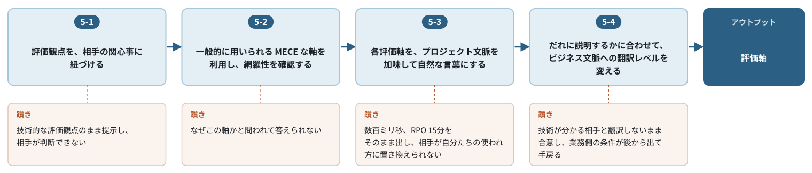

- （5-2）技術的な観点を、相手の関心事、中分類、大分類へと抽象化する。大分類には QCD のような網羅性のある軸を使う（→Appendixの、評価軸に借りる既成の軸）。抽象化すると、コストや法令は相手の価値判断、実装の容易さは自分たちの判断、と分解できる
- （5-3）評価軸の名前は、相手が何を決めるのか、どちらに寄せると何が困るのかが分かるものにする
- （5-4）相手がビジネス部門なら大分類まで、要件定義の担当なら関心事まで上げる

::: info 在庫連携の例

鮮度は、何分前の在庫数で注文を受けてよいか。障害が波及する範囲は、基幹が止まったときにECでも注文を止めてよいか。改修量は、基幹側の改修費と時期。再送の仕組みは、言い直しても相手の関心事にならない。

:::

::: info 関心事への抽象化の例

| 大分類 | 中分類       | 関心事                   | 相手の言葉に直すと                                           | 技術的な観点                                             |
| :----- | :----------- | :----------------------- | :----------------------------------------------------------- | :------------------------------------------------------- |
| Q      | 性能効率性   | ユーザー体験             | 利用者が操作のたびに遅延を感じないか                         | 応答時間、レイテンシ、拠点からの物理的な距離             |
|        | セキュリティ | データの所在             | 自社のデータを国外で保管してよいか                           | 越境データ移転の制約、監査ログの保持先                   |
|        | 保守性       | 内製化のしやすさ         | 運用にどれだけ手間や高度なスキルが要るか                     | 監視の複雑性、インフラコードの分岐                       |
| C      | 運用費用     | コスト                   | 月々のランニングコスト                                       | インスタンス単価、データ転送量、リザーブド購入による割引 |
| D      | 日程の確実性 | 開発リードタイムのリスク | 必要な機能が揃っていて、作り込みなしで予定どおり構築できるか | サービスの提供状況、新機能が展開されるまでの期間         |

そのままでは相手の関心事に見えない観点も、言い直せることがある。たとえば開発効率性は、納期を気にする相手には、使えるサービスが限られると構築が1〜2週間延びる、と言い直せる。言い直せない観点は、今回の評価軸から外す。

:::

## 手続き6 評価軸から、コンセプト別の選択肢を作る

コンセプト名で、何を優先し何を許容する案かが分かれば、相手は案を選ぶことで重視するビジネス観点を選べる。

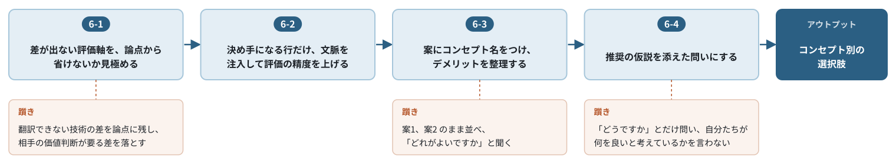

- （6-1）相手が自分の言葉で答えられる形に言い直せない差は、問いにせず、技術で決まる事項として報告する。報告のうち、打合せで伝える価値が高いのは、一択になった理由が相手側の前提によるもの（海外拠点がないからデータは国内保持、など）、相手のその後の業務や運用に影響するもの、後から覆せないものの3つである。それ以外は資料の補足や文書での報告にとどめてよい
- （6-2）手続き4-3 で仮に付けた評価のうち、問いの決め手になる観点だけを、ここで確かめ直す
- （6-3）コンセプト名にはデメリットもあわせて書く。コンセプトは、評価軸を大分類まで上げると見つけやすい（→Appendixの、コンセプト別の選択肢のパターン）。差の大きさは◯△×だけでなく数値で書く。コストを優先しない相手でも、費用が5倍になる案は選べない。相手が到底飲めないデメリットは、重みの問題ではなく隠れた要件の未達なので、選択肢として出す前に確かめる
- （6-4）推奨案を添えて、どちらのコンセプトを取るかを問う。コスト差が小さければ「品質優先A案を推奨するが、このコスト差は許容できるか」、コスト差が大きい割に得られる効果が小さければ「コスト最適化B案を推奨し、セキュリティや性能は別の施策で緩和する形がよいと考えるが、どうか」という問いになる

::: info 在庫連携の例

基幹の改修を抑えて早くリリースする案（15分ほど前の在庫数で注文を受けるので、売り越しが出うる）と、売り越しをなくすリアルタイム案（基幹の改修に◯万円かかり、基幹が止まるとECでも注文できない）を作る。早期リリース案を推奨するが、売り越しを取り寄せで吸収できるか、と問う。再送の仕組みは資料の補足にとどめる。

:::

::: info （6-1）論点かどうかは、プロジェクトの文脈で変わる

データ主権は一般には重要な観点だが、国内でしか事業をしていない相手なら国内保持しか選ばないため、論点にならない。運用保守性は、稼働後に相手自身が運用を引き継ぐなら相手の価値判断だが、自分たちが運用まで行うなら技術で決まる事項になる。

:::

::: info （6-1）構成図の合意にも、問いと報告の選り分けが使える

構成図のように多くの要素を1枚に載せる資料でも、全体の合意を直接取ろうとしない。要素ごとに、一般的な構成として示す報告か、相手の価値判断が要る問いかを選り分ける。
クラウドのアカウント構成図なら、開発・検証・本番の環境断面を分けるのは一般的な構成として示すにとどめ、合意を求めるのは監査ログやセキュリティのアカウントを分けるかどうかだけにする。後者は、相手の体制で答えが変わるためである。

:::

::: info （6-3）バランス案、ハイブリッド案という名前に気をつける

バランス案やハイブリッド案という名前は、どの評価軸も中くらいに見えるため、深く考えずに選ばれやすい。中身が同じでも、何を優先した案かで名前を付け直す。デメリットで言い直すと、さらに冷静に比べられる。

- ❌ バランス型
- ✅ 段階的スモールスタート型（初期にはすべてを作らない）
- ✅ 既存踏襲型（新規要素は加えない）

:::

## 手続き7 説明用のストーリーと伝え方を組み立てる

コンセプト別の選択肢と推奨案を、相手が理解できる流れに組み立てる。

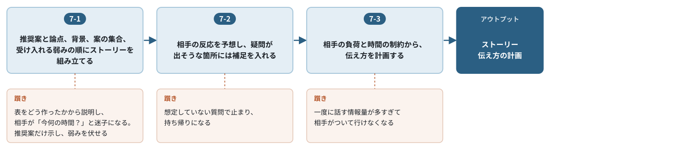

- （7-1）ストーリーの要素ごとに、次を押さえる
  - 冒頭で、何を提案し、何を合意したいかを言い切る。決め手（何を優先するからこの案か）を一言で伝える。推奨案が無いと、判断を丸投げしているように見える
  - 背景には、資料が何を扱うかではなく、次に何をするために今これを決めたいのかを書く。課題の出どころ（だれの要望か、どの検討から出たか）と、検討の前提（相手側の方針、体制、期限など）も書く
  - なぜこの N 個の案なのかを、手続き4-1 で整理した、候補に挙げた理由と外した理由で説明する。比較表は細かく説明せず、どういった観点で差が出たかポイントを伝える
  - 受け入れる弱みは、はっきり書く。ぼかしたまま進めると、リスクの許容度が違う別の利害関係者に後で覆されることがある
- （7-2）相手の上司など、別の利害関係者が指摘しそうな箇所にも、だれがどう気にしそうかを添えて補足できるとなお良い
- （7-3）1回の打合せの時間と、相手が一度に理解できる量に収まるかを見て、何回に分けるかを決める。初手の打合せでは、推奨案のデメリットと緩和策は Appendix に載せる。最初に聞きたいのは、推奨案を見て相手がどういう感想を抱いたかであり、弱みの細部まで話すと情報量が多すぎる

::: info 在庫連携の例

背景には、方式が決まらないと基幹側の改修見積もりが出ず、来期の予算に間に合わないことを書く。受け入れる弱みは15分ほどの遅れによる売り越しで、緩和策は売り越した分を取り寄せで納めること。

:::

::: info （7-1）背景の例

背景に書くのは、手続き1 で洗い出した作業のうち、この検討事項が決まらないと着手できないものである。

- ❌ 「DWHのアーキテクチャ設計をしたい」
- ✅ 「年明けからDWHの本番環境を構築するため、PoC構築と並行して構築のWBSを作る必要がある。WBSはアーキテクチャの構成要素ごとに作るので、計画の段階で、構成要素を洗い出せる粒度までアーキテクチャを設計したい」

:::

## 手続き8 相手の反応を引き出し、合意する

要望を聞くのではなく仮説を示し、返ってきた反応で、相手の判断基準の見立てを更新する。

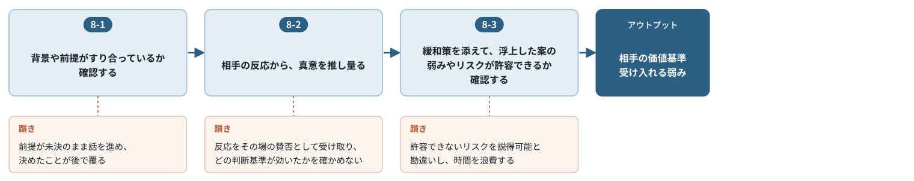

- （8-1）話してみると、前提とした事項がまだ決まっていなかったと分かることがある。そのまま進めて良いことは無いので、その場で前提を確認する時間とするか、「前提を確かめたうえで、別の場を設定させてください」と言って仕切り直す。前提を確かめたら、手続き4-3 に戻って検討をやり直す
- （8-2）返ってきた反応から、相手がどの判断基準で答えているかを推し量る。仮説が当たっていても、相手がなぜ頷いたのかを確かめておくと、次の論点で判断基準を当てやすくなる
- （8-3）推奨案への感想を聞いた後で、Appendix に載せたデメリットと緩和策を示し、推奨案の弱みを許容できるかを確かめる。許容できないときは理由を確かめる。隠れていた制約なら手続き4 に戻って案を落とし、重みの付け方の問題なら手続き5 に戻って評価軸を組み替える。弱みを本当に受け入れたらどうなるか、と想像してもらえるように語ることがコツである

::: info 在庫連携の例

「限定品のセールだけは売り越しが許されない」と返ってくる。隠れていた制約なので手続き4 に戻る。限定品では差分連携が制約を満たさないので、限定品だけ注文時に API で引き当てる案を作り、基幹の改修費を見積もり直す。

:::

::: info （8-3）緩和策は、4つの型から考える

相手が弱みを許容できないときも、別の型の緩和策なら許容できることがある。

- 回避: 弱みが生じる条件そのものを外す（見込みが立つまで専用の環境を作らない、など）
- 低減: 起こりやすさか、起きたときの影響を小さくする（リハーサルを増やす、戻す手順を決めておく、など）
- 転嫁: 影響を別の主体に移す（運用を自分たちが引き受ける、保守契約で賄う、など）
- 受容: 手を打たずに受け入れ、起きたときの対応だけを決めておく。受け入れる理由も書く

:::

## 手続き9 クロージング

どういう経緯と価値判断で何を決定したかを文書化する。

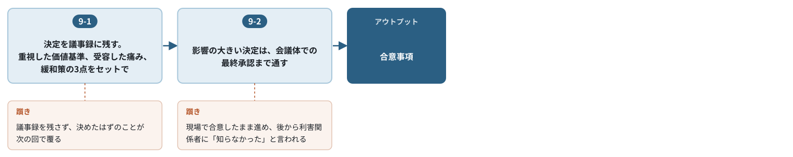

- （9-2）影響の大きい決定は、現場での一次合意に加えて、全体会議などでの最終承認まで通す。どのテーマでどこまで承認を得るかは、相手側の会議体を把握したうえで、本来はプロジェクト計画時に決めておくべきである

::: info 在庫連携の例

通常の商品は15分ごとの差分連携、限定品は注文時に引き当てる、と決まる。重視した点（通常の商品のリリース時期、限定品の売り越し防止）、受け入れた弱み（通常の商品は売り越しが出うる、限定品は基幹の停止中に注文できない）、緩和策を議事録に残す。基幹の改修費を伴うので、情報システム部門を含む会議で承認を得る。

:::
