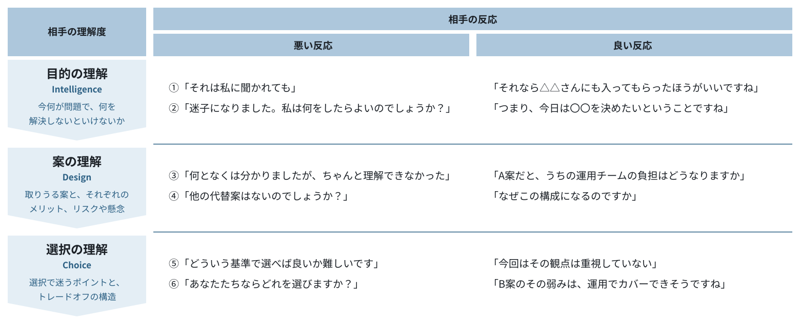

<!-- ケーススタディの相手向けの資料と、相手の発言の引用はですます調のため -->
<!-- textlint-disable ja-technical-writing/no-mix-dearu-desumasu -->

# 失敗パターンと処方箋

相手の反応から、相手の理解がどの段階で止まったかと、甘かった手続きを推測できる。会議の振り返りにも使える。

_段階の区分は、サイモンの意思決定モデル（Intelligence → Design → Choice）による_

## ①「それは私に聞かれても」

アカウントの分割単位やリソースの命名規則のような技術的な設計事項を、相手の言葉に直さずにそのまま聞いている。相手には、なぜ自分が問われているのか、そもそも答える必要があるのかが分からない。

- 処方箋: 手続き6-1（報告と問いの切り分け）。答える人が違うなら手続き1-3（答える人の対応付け）
- 良い反応: 「それなら△△さんにも入ってもらったほうがいいですね」。相手が、答えるべき人を自分から挙げており、自分ごとと捉えている

::: info 失敗例: 「データ基盤のレイヤーは3層でよいですか？」と相手に聞いてしまう

- **状況**: データ基盤構築プロジェクトで、メンバーが DWH の論理的なデータ格納層の設計方針を固めたい
- **課題**: 格納層を3層にしてよいか、名前はブロンズ・シルバー・ゴールドでよいかを相手に確認した。相手は判断できず、説明を重ねるほど「よく分からない」という反応になった
- **原因**: 層の数や名前をどう決めても、相手が何かを優先したり諦めたりすることはなく、相手の価値判断に繋がる余地はない。自分たちで決める設計項目を、問いにしていた
- **対応**: 「データ層は3層構成にしました。各層の役割はこうです」と、決めた結果として報告する。レイヤーの分け方と名前は相手が後でデータを探すときに使うので、報告からは省かない

:::

::: tip 「私に聞かれても」と言われる設計事項

表現の言い換えで相手の関心事に届くかどうかで、処方箋が決まる。

| #   | 例                           | 処方箋                                                                                                 |
| :-- | :--------------------------- | :----------------------------------------------------------------------------------------------------- |
| 1   | クラウドアカウントの作成単位 | 請求の分け方、本番を操作する人の範囲、監査ログをだれが見るかに言い直せば問いになる。構成そのものは報告 |
| 2   | コストタグの構造             | 請求をどの軸で見たいかだけを問う。キー名は報告も要らない                                               |
| 3   | リソースの命名規則           | 既存の標準や規程があるかを確認する。なければ方針を報告する                                             |

一つひとつは軽いが、積み重なると時間を奪う人と見られ、信頼を損なう。会議の前に設計項目を相手の判断しやすい観点に翻訳できないか確かめる。

:::

## ②「迷子になりました。私は何をしたらよいのでしょうか？」

なぜ今この話をするのかという背景を伝えないまま、話を進めている。相手は、この場が報告を聞く場なのか何かを決める場なのかが分からず、話が頭に入らない。

- 処方箋: 手続き7-1（背景）
- 良い反応: 「つまり、今日は〇〇を決めたいということですね」。相手が場の目的を自分の言葉で言い直している

## ③「何となくは分かりましたが、ちゃんと理解できなかった」

各案の特徴を、技術的な専門用語を並べて説明し、相手を混乱させている。数百ミリ秒の遅延や RPO 15分を、業務への影響に置き換えずにそのまま話すような場面である。推奨案や計画のリスクを示さず、相手が何を受け入れるのか分からないまま聞いている場合もある。

- 処方箋: 手続き5-2（抽象化）を行い、そもそも技術論を話の中心にしない。リスクを示していない場合は手続き7-1（受け入れる弱み）
- 良い反応: 「A案だと、うちの運用チームの負担はどうなりますか」。相手が案を自分たちの業務に当てはめて考えている

::: info 失敗例: 年内スケジュールのWBSを、リスクや考慮点を示さずに出した

- **状況**: 年明けからの本番構築に向けて、年内に行うアーキテクチャ検討のスコープと想定WBSを相手と合意したい
- **課題**: 相手の反応は「ふーん」だけで、質問が出ないまま合意したように見えた。後の打合せで、年内に終わらない要素や外した要素の話が出たときに「そのリスクは聞いていない」「あのときもっと説明してほしかった」となり、信頼を損なう
- **原因**: この計画の主なリスクや影響度（年内に終わらないおそれがある要素と、遅れたときに本番構築で止まる作業）を示していなかった。そのため相手は、何を許容しなければならないか気づかないままだった
- **対応**: 計画における主なリスクと、そうなったときに後ろ倒しできる要素を添え、そのリスクを許容できるかを相手と合意する。もし、スコープアウトしたものがあれば、「1月以降」の列に要素ごとの理由を付けて並べる

:::

## ④「他の代替案はないのでしょうか？」

「この案でいいですか」と、決め打ちの案だけを示している。マルチテナントのデータ分離で、RLS による論理分離の案だけを持っていき、これでよいかだけを聞くような場面である。相手からは、少なくともアプリケーション側で分離するやり方もあるのでは、と反応された。ほかの案を考えていない場合と、案は考えたが絞った理由を見せていない場合がある。相手は、結論ありきで誘導されていないか、他の手段と比べたうえでの案なのかを不安に感じている。

- 処方箋: 手続き3-1（案出し）。案を絞った場合は手続き4-1（絞った理由）
- 良い反応: 「なぜこの構成になるのですか」。相手が案の並びに納得し、推奨の根拠を確かめに来ている

## ⑤「どういう基準で選べば良いか難しいです」

方式の比較を並べただけで、どの案が何を優先するものかを示していない。◯△×の比較表を見せて「どれにしますか」と聞くような場面である。相手には、コストと品質のどちらを優先するかといった自社の優先度と、表の◯△×がどう結びつくのかが分からない。

- 処方箋: 手続き6-3（コンセプト名とデメリット）
- 良い反応: 「今回はその観点は重視していない」。相手が判断基準を自分から示している。否定的な反応と受け取らなくてよい

## ⑥「あなたたちならどれを選びますか？」

事実を列挙するだけで、提案になっていない。相手は比較の中身を理解したうえで、専門家としての判断を聞いている。

- 処方箋: 手続き6-4（推奨案を添えた問い）。推奨案が未定なら手続き4-5
- 良い反応: 「B案のその弱みは、運用でカバーできそうですね」。相手が推奨案の弱みを理解し、受け入れ方を自分から考えている

::: info 失敗例: 「気になる点があればご指摘ください」と記載してしまう

- **状況**: データ基盤 PoC の週次定例。メンバーは構築の経験は長いが、要件定義への参画は初めて
- **課題**: 主要製品4つを9つの観点で比べた表を作り、各ページのリード文を「◯◯を整理しました。気になる点があればご指摘ください」とした。推したい製品はあったが、資料には書いていなかった
- **原因**: 推奨したい製品を、どの評価軸を重く見たからかという理由とともに言葉にしていなかった。そのため、相手に求めるものが評価軸への同意か、候補の確認か、製品の決定かも決まっていなかった
- **対応**: ◎や×の数では決めず、Snowflake と Databricks の2案に絞る。「運用に人を割かずに済む Snowflake を推奨する。Databricks は非構造データまで扱えるが、使いこなせる人の確保が要る。非構造データは今回の対象に含めるか」と、推奨案を添えて問う

:::
