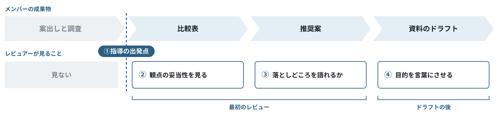
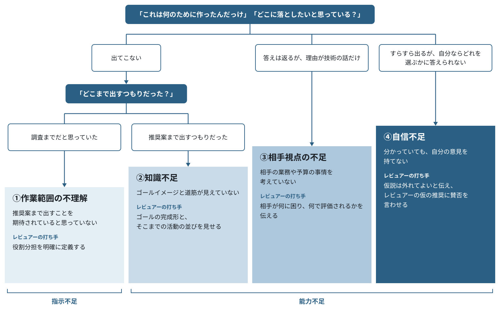
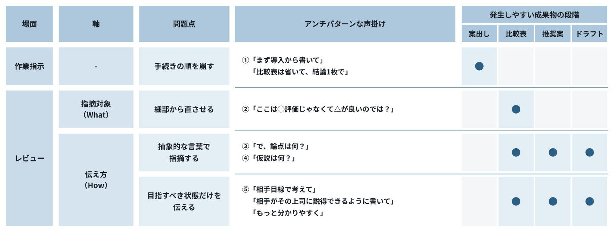

<!-- ケーススタディの相手向けの資料と、相手の発言の引用はですます調のため -->
<!-- textlint-disable ja-technical-writing/no-mix-dearu-desumasu -->

# レビュー技術

レビューの役割は、資料の良し悪しを判定することではなく、メンバーが手続きのどこで詰まっているかを見極め、次に何を考えればよいかを伝えることである。

## レビューでの見極め方

レビューを始める前に、メンバーの成果物がどの段階にあるかを見極める。

### ①比較表が出てきたところが、指導の出発点

最初のレビューは、仮の比較表と推奨案ができた時点で行う。そこまでは経験の浅いメンバーでも AI を使って作れ、指導が要るのはその先だからである。

### ②比較表のレビューでは、中身より観点の妥当性を見る

初期段階では、◯△×を精緻に埋めさせず、観点が妥当か、相手の関心事に合っているかを先に確かめる。

- 観点がずれていると、◯△×を正確に埋めた調査や検証が手戻りになる
- 仮の◯△×なら、一部が空白でも、優劣の傾向と、どこが論点になりそうかは掴める

観点を分類する軸（QCD や品質特性など）は、最初はレビュアーが示す。

### ③落としどころを語れるかで見極める

観点を確かめたら、「なぜこの案を推奨するのか」と聞く。「要件が◯◯だと仮定すれば、△△の観点でこの案がよい」と自分の言葉で言えればよい。言えなければ、闇雲に進めている懸念がある。相手に持っていく前に、チーム内で仮説を立て直す。

_覚悟の問題に見えるもの_

図の①は、役割分担が曖昧なプロジェクト初期に起きやすい。図の②と③は、進め方の指導で解ける。図の④は、道筋も相手の事情も見えているのに、自分のスタンスを決められない状態である。自分ならどれを、何を理由に選ぶかを言わせる。

### ④目的は、ドラフトの後で言葉にさせる

メンバーはまず中身を作るので、リード文が「違和感はあるか」「Aで進めてよいか」という作成者目線になるのは自然である。ドラフトを見た後で、目的を言葉にし直すステップを設ける。

1. ドラフトを見て、相手からどんな質問や反論が出そうか、どこで合意が詰まりそうかを想像する
2. 該当ページで相手に求めるアクションを、5形式（→Appendixの、相手へのコミュニケーションは、5形式に分類できる）から選び直す
3. 定義した目的に合わせて、ページ構成やメッセージラインを組み直す

最低でも、ページごとに「このページの意図は◯◯です」と一文を付箋で書いてもらう。非機能要件の基礎数値を集めるページなら、「見積もりの費用計算、非機能のテストケース、監視設計に使うため」と書いてあれば、相手はそのページの位置づけと重要度が分かる。

## アンチパターン

レビュアーが言いがちだが、メンバーの手を止めてしまう声かけを挙げる。①②は特定の段階で、③〜⑤はどの段階でも出やすい。

### ①「まず導入から書いて」「比較表は作らずに、結論1枚でまず作って」

どちらも、ベテランが無意識にやっていることをそのまま指導に持ち込んでいる。導入は中身の解像度が上がってから書けるもので、先に書かせると、書き出した仮説に縛られて中身が進まなくなる。比較表を省けるのは、省いた分を知見と相手との信頼で補える人だけである（→ベテランの視点の、手続きを省けるのは、省いた分を信頼で埋められる人だけ）。

9つの手続きを順に踏ませる。まず手を動かせる具体を作らせ、何が論点になるかを一緒に見極める。

### ②「ここは◯評価じゃなくて△が良いのでは？」

細部の採点を直させると、メンバーは表を埋める作業に没頭し、相手への翻訳に頭が回らなくなる（→レビューでの見極め方の、②比較表のレビューでは、中身より観点の妥当性を見る）。

「◯△×は仮でいい。この表を相手が読める大分類に束ねると何になる？」と、手続き5 の翻訳へ視点を上げる。明らかに間違っている部分はさっと伝えるか非同期でコメントする。

関連する手続き: 手続き4-2、5

### ③「で、論点は何？」と抽象的に詰める

論点という言葉は抽象度が高く、慣れないメンバーは手が止まる。論点は案を比べた差から生まれるので、手前の整理がないまま問うても出てこない。

「案は何通りある？」「それぞれで何が変わる？」と、前提となる事実確認から問う。比較表ができていれば、「この表で、相手の価値判断が必要なのはどの行？」「それが決まらないと、自分たちの作業は止まる？」「それが決まると、だれがどう嬉しい？」と問い、相手に問うものと報告で済むものを分けさせる。

関連する手続き: 手続き3、4、6

### ④決断を促そうとして「仮説は何？」と聞く

「仮説」は抽象度が高い言葉で、何を仮説と呼ぶかの基準が無い。本人なりの考えはあるので、「それは仮説ではない」「仮説です」の押し問答になりやすい。仮説という言葉は使わず、何についての考えを聞きたいのかを、資料の状況に合わせて具体的に問う。

- 作成途中なら、「ここまでよく作ったね。この後どうしたい？」と受け止めてから問う
- 前提が分からず手が止まっているなら、「どういう前提で作ろうとしている？」と問う
- 資料ができていれば、「打合せ当日、相手にどう説明する？」と問う。説明の場面を考えると、指摘しなくても自分から直す箇所を挙げてくる
- 懸念が見えているなら、「その懸念に対して、どういうストーリーなら納得させられると思った？」と問う

相手の気持ちの仮説すら立たない状態なら、過去プロジェクトのお手本を渡す。

関連する手続き: 手続き2-3

### ⑤「相手目線で考えて」「相手がその上司を説得できるように書いて」「もっと分かりやすく」

いずれも目指す状態であって、考え方ではない。足りないのが、目的、評価軸、コンセプト別の選択肢、推奨案、ストーリーのどれなのかを特定して伝える。

関連する手続き: 手続き5、6-3、7-1
