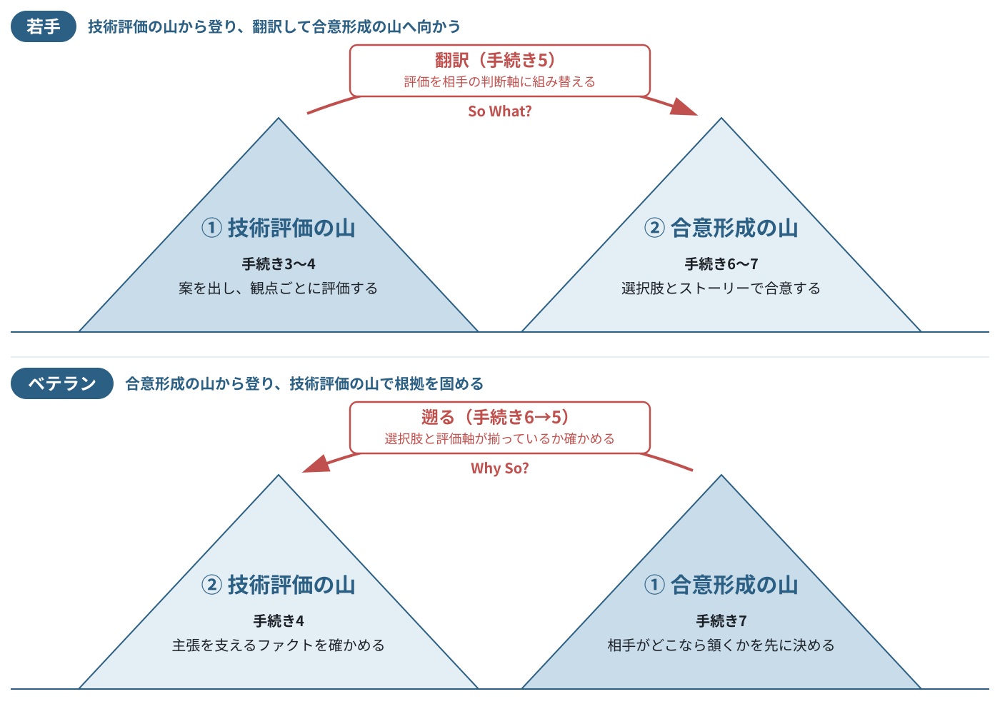
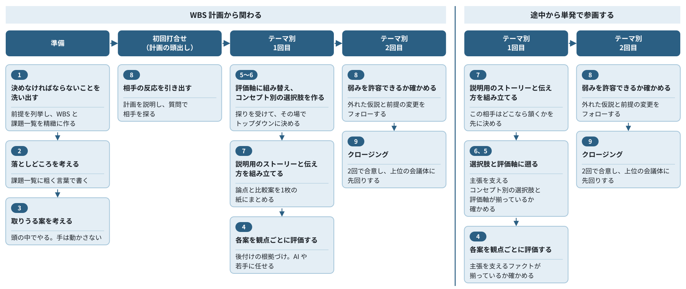
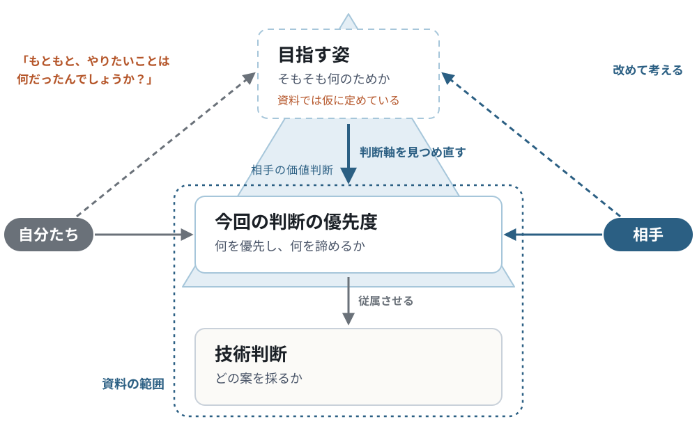

<!-- ケーススタディの相手向けの資料と、相手の発言の引用はですます調のため -->
<!-- textlint-disable ja-technical-writing/no-mix-dearu-desumasu -->

# ベテランの視点

## ベテランはどう省いているか

技術評価と合意形成を2つの山とみると、メンバーとベテランでは登る順番が違う。メンバーは技術評価の山を登ってから、その評価を相手の評価軸に翻訳して合意形成の山へ向かう。ベテランは先に合意形成の山を登り、相手がどこなら頷くかを見立ててから、なぜそう言えるかを技術評価の山で後から固める。

_要求工学のツインピークスモデルを、技術評価と合意形成の2つの山に当てはめた_

WBS 計画から関わる場合と、途中から参画している場合で動きが変わる。

WBS 計画から関わる側の詳細を示す。カッコ内は対応する手続きの番号である。

- （1）～（3）前提と必達の要求を列挙し、想定アウトプットから逆算して WBS と課題一覧を作る。課題ごとに論点、仮説、落としどころ、相手が気にしそうな箇所、だれが決められそうかを書き込み、書き込みが多い課題だけ資料にする。相手側の担当者が異なる課題は会議体を分ける
- （8）初回: 事前に、自分たちが分かっていないことを質問として洗い出す。初回は打合せ計画を説明し、影響の大きい質問で相手の価値判断、組織、キーマンを探る。合意を求めるのは、検討の進め方と打合せ計画までにとどめる。本音の判断基準を探るのに、他社の事例を当てて反応を見る人もいる
- （5〜6）初回の探りでトップダウンに評価軸を決め、その大分類からコンセプト別の選択肢を作る。選択肢は事前に作り込まず、その場で組み立てることもある
- （7）資料はディスカッションペーパー1枚にとどめる。論点と比較案を載せ、流れは口頭で補う
- （4）推奨案を先に決め、比較表はその検証に使う。作成は AI やメンバーに任せる
- （8）2回目以降: 外れた仮説と前提の変更を反映し、推奨案に残る弱みを緩和策込みで許容できるか確かめる
- （9）各テーマ2回での合意を目安にする人もいる。合意できないものはチケットにし、期限と確認先を相手と決める。クリティカルパスなら3回目を設け、遅延への対応を推奨案として示して合意する。影響の大きい決定は、経営層へ先にインプットしておく

::: warning 手続きを省けるのは、省いた分を信頼で埋められる人だけ

早い段階で筋のよい質問をして信頼を得ておくと、後の合意が進めやすい。仮決めで先に進めて後で回収する動きは、信頼のないうちにやると、後で覆らないかと相手を不安にさせる。省くかどうかは、力量、テーマの重要性、相手がその進め方を受け入れるかで決まる。

:::

## ジャブで関心事を引き出す

会議1回で全部を決めることは、ベテランでも容易ではない。そのため、作成途中で相手に見せ、反応を得ながら進める。本書ではこれをジャブと呼ぶ。相手にとっても、事前に見ておけば考える時間が取れ、社内の有識者に聞くこともできる。

1. 整理の途中だと伝える。「いま比較を整理している途中で」前置きして反応を見る
2. 詳細は調査中であっても、仮の見立てを出す。「この軸だとこれが優先になりそう」と、手続き2 の落としどころと手続き5 の評価軸を仮のまま示す。白紙で「何を重視されますか」と聞くと相手の負担になる。当たりに自信が持てないときは、定例とは別に10〜15分のヒアリングを設けてもよい。仮説を持っていき、この相手とは話す価値がある、と思われて初めて本音が出る
3. 気にしていること、足りない情報を聞く。「他に気にしていることはあるか」「関連する資料を受領できるか」と、定例の冒頭や雑談で、前提の確認として聞く。正規の議題にすると相手は付加価値を感じにくいため、できれば避ける

## 合意は資料を出した後の会話で決まる

ケーススタディは、初回打合せの想定で作成している。説明資料が扱うのは、技術判断と、それを従属させる1段上の相手の価値判断までである。その上位にある目指す姿は、資料では仮に定めている。メンバーは、資料を出せばその内容を議論すると捉えがちである。実際には、資料を足場にした会話の中で、相手側の担当者同士が話し始めたり、「それなら上に確かめましょう」となることもある。この脱線は、目指す姿から判断軸を見つめ直す機会になる。そのため、ベテランは打合せの途中で、「もともと、やりたいことは何だったんでしょうか？」と問いかけ、相手が改めて考える余地を作り、より本質に迫る議論に話を持っていくこともある。

::: info 生成AIのケースの例

DX 戦略が決めているのは、生成AIを使うことだけである。効率化、人員削減、サービスレベルの向上、負荷の軽減のどれを優先するかは、相手もまだ決めきれていない。資料の整理を足場に「そもそもこれは、どういう経緯で決まったんでしたっけ」と問い、相手が目指す姿を改めて考えてもらう。

:::

## 相手が自分で考えたという納得感を重視するとき

業務やUIの仕様のように、相手が自分で考えることを重視する状況では、1回目に推奨案を出し切らない進め方も有効である。1回目は前提と課題、基礎的な案だけを示し、相手の意見を聞く。推奨案は、この時点で手元に固めておく。2回目に、そのコメントを踏まえて練り直した案として推奨案を示す。自分の意見が反映された案なので、相手は納得感をもって自身の利害関係者に報告しやすい。
