<page-title/>

<!-- ケーススタディの相手向けの資料と、相手の発言の引用はですます調のため -->
<!-- textlint-disable ja-technical-writing/no-mix-dearu-desumasu -->

本書は、プロジェクト推進のために解決すべき検討テーマを相手と円滑に議論し、合意形成へ導くための手続きをまとめたものである。[ソフトスキルガイドライン](./softskill_guidelines.md)の（4）説明力のうち、合意形成を詳しく扱った派生編にあたる。

位置づけ・免責事項は [Introduction](./index.md) を参照。

# はじめに

資料を準備してたくさん話したのに、伝わらない、決まらない。たとえば次のような場面である。

- 目的や文脈を話さず詳細説明に入り「これ何の時間？」
- 比較表の特徴は説明したが「で？」
- 「技術的には A の方式が優れています。これで良いでしょうか？」と技術の優劣だけで押して、ハレーション

言い方の問題に見えるが、ベテランが暗黙のうちに押さえている勘所が抜けている場合がある。その思考の流れを9つの手続きに分解して示す。

## 想定読者

合意形成に悩むメンバーと、そのレビュアー。メンバーはセルフレビューに、レビュアーはメンバーがどこで躓いているかの特定に使える。

なお、検討テーマ自体を決めるためのタスクの分解術や、純粋な技術のあるべき論を考えるプロセスは、本書のスコープ外とする。

# 合意形成とは何か

合意形成とは、立ち位置や知識量の異なる相手と自分たちが、見えているものや重視するもののずれをすり合わせ、根拠に基づいて一致した結論を出すことである。相手を言い負かすディベートではない。

本書の手続きは、相手の価値判断を確かめて案を選ぶ場面にも、自分たちが推す案の理由を伝える場面にも使える。

# 合意形成の構造

決めたいことには複数の選択肢があり、それぞれにメリット・デメリットがある。何を優先し、どのリスクを許容するかを相手と揃えておかないと、後で手戻りになる。自分たちが決めたいのは技術方針だが、その一段上には、それを左右する相手の価値判断がある。相手と合意するのはこの価値判断であり、それが決まれば技術方針が決まるように組み立てる。

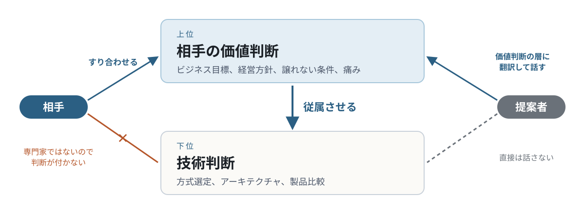

技術的な特性のまますり合わせようとすると、打合せがITの勉強会になり、時間を浪費する。

DWH の製品を決めたいとする。その一段上には、内製化のしやすさ、運用の手離れ、既存資産との親和性のうち何を優先するか、という相手の価値判断がある。内製化と Google アカウント連携を優先するなら BigQuery、運用の手離れを優先するなら Snowflake、既存の AWS 資産との親和性を優先するなら Redshift になる。「◯◯が決まれば、今回決めたいことが決まる」の◯◯を探し、その◯◯を決めるための論点を作る。

# 心構え

心構えを、自分たちと相手、結論と根拠の4つに分けて示す。
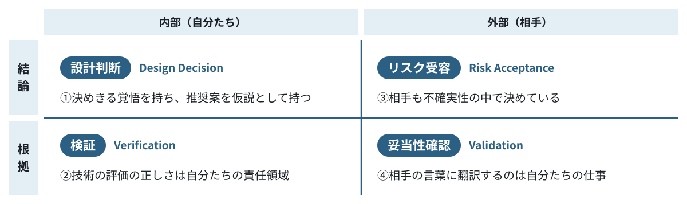

_列は自分たちと相手、行は結論と根拠で分けた。根拠の行は、ソフトウェア工学の V&V（Verification: 正しく作っているか、Validation: 正しいものを作っているか）に対応する_

1. **決めきる覚悟を持ち、推奨案を仮説として持つ**
   だれかが決めてくれるとは思わない。一歩引いた評論家ではなく実務家として、自分ならどれを、何を理由に選ぶかを決める。どう着地させるかの道筋を、常に自分で持っておく。
2. **技術の評価の正しさは自分たちの責任領域**
   技術の評価は客観的かつ誠実に行う。◯△×が正しいかを相手に確かめてもらわない。なぜその評価になったかを、自分たちで説明できるようにしておく。
3. **相手も不確実性の中で決めている**
   相手も、判断を誤れば立つ瀬が無く、上への調整も抱えている。整理したのに決断してくれないという他責の姿勢では進まない。同じミッションに向かう仲間として敬意を払い、どこに引っかかるかを引き出す。
4. **相手の言葉に翻訳するのは自分たちの仕事**
   技術そのものを分かってもらおうとせず、相手の価値判断の言葉に置き換える。自分が相手の立場なら、この内容で判断できるかを自問する。

# 合意形成の手続き

全体像を示す。

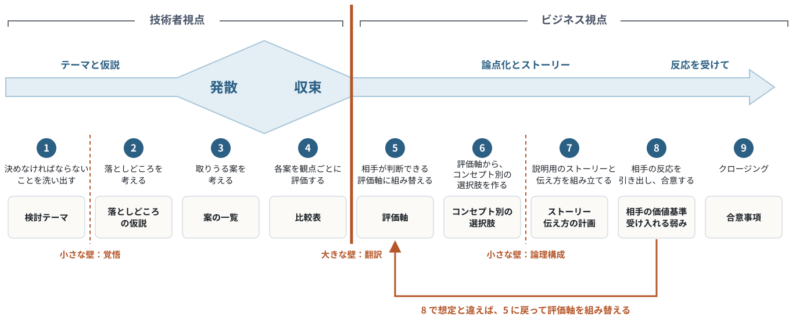

手続き4 までは技術者の視点で進められる。手続き5 からは相手の目線に切り替えるため躓きやすく、レビュアーのフォローが要る。

検討テーマが変わっても順序は同じで、どの手続きが重くなるかが変わる（製品選定なら手続き4 の絞り込み、処理方式の検討なら手続き5 の組み替え）。

::: info ECサイトと基幹システムの在庫連携の方式を決める例

手続きごとにECと基幹システムの在庫連携についての例を記述する。現状は、夜間の一括連携のため、日中に売り越しが続いているという設定である。

:::

# 手続き1 決めなければならないことを洗い出す

未決事項を洗い出し、何をだれと合意するかを決める。

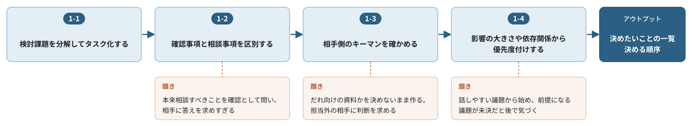

- （1-2）確認事項は、海外拠点の有無のように、相手から事実として答えが返ってくるものである。相談事項は相手の価値判断が要るもので、セットで推奨案を添える
- （1-3）資料がだれ向けかが決まっていないと、説明の筋が妥当かを判断できない。相手は相手側の担当者と統括のように多段階のことも、論点ごとに答えられる人が違うこともある（待ち時間の許容は業務部門、操作記録の要否は監査やセキュリティの部門など）。分からなければレビュアーに相談するか、仮説を添えて相手に確かめる
- （1-4）優先度は、タスク同士の依存関係、リードタイム、決定を後から戻せるかで決める。全体量と優先度を先に合意しておくと、個別の打合せで、なぜ今この話をするのかを説明でき、ハレーションが生じにくい

::: info 在庫連携の例

確認事項は、基幹システムに在庫を返す API があるか、改修を頼める時期はいつか。相談事項は、在庫数がどれだけ遅れて見えてよいか。相談事項はEC事業部の責任者に、確認事項は情報システム部門に持っていく。

:::

# 手続き2 落としどころを考える

相手の判断基準（相手が何を重く見て決めるか）に当たりをつけ、落としどころとなる推し案（仮説の段階の推奨案）を作る。この段階で作るのは、後続の調査や比較に際限なく時間を使うのを防ぐためである。

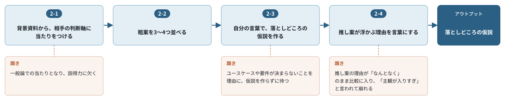

- （2-1）～（2-2）提案書、契約、過去の議事などを AI に読み込ませて、プロジェクト固有の背景知識を抽出させる。そして、コスト、スピード、セキュリティなどのどれを優先しそうかを見立て、粗案まで出しておく。見立てに自信が持てないときは、作成途中で相手に見せて確かめる（→ベテランの視点の、ジャブで関心事を引き出す）
- （2-3）推し案の仮説は外れてよい。仮説を否定されれば、判断基準の見立てのどこがずれていたかが明確になり、次善案の精度が高まる
- （2-4）推奨理由は、社内事例、相手が打合せで漏らした言葉、製品の勢いといった直感が出どころでもよい。直感が正しかったかは、案を評価するときに確かめる

::: info 在庫連携の例

相手はリリース時期と基幹の改修費を重く見ると見立て、15分ごとの差分ファイル連携を推し案にする。基幹側の改修が小さく、売り越しは取り寄せで吸収できると読む。

:::

# 手続き3 取りうる案を考える

論点は案同士を比較した差から生まれるので、案が1つでは先に進めない。比べた案が多いほど、残った案を選んだ根拠が強くなり自信が持てる。詳しくない領域では、AI にできるだけ多く案を出してもらう。

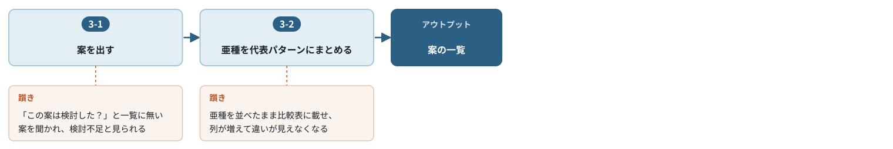

- （3-1）案出しのテクニック
  - 代替案が思いつかないときは、現状維持を1つの案として並べる
  - 実施スコープを決める題材では、松竹梅の3案を作り、推奨を竹とする。相手は範囲とコストを天秤にかけて選べばよいので、判断しやすい
  - SaaS かフルスクラッチかのような二者択一では、ハイブリッドも案に加える。ハイブリッドにも濃淡があるので、濃淡ごとに亜種として出しておく
- （3-2）似た案は、どの観点で違うかを見て代表パターンにまとめ、代表の下に添える。絞るのではなく整理する段階である。整理すると、パターンの空白から別の案が見つかることもある

::: info 在庫連携の例

夜間の一括ファイル連携（現状維持）、15分ごとの差分ファイル連携、注文のたびに基幹の API で在庫を引き当てる、在庫の変更をイベントで送る、基幹の DB を直接参照する、の5案を挙げる。

:::

::: tip （3-1）実質的に1つしか案がない場合

計画策定時のスケジュールのように、スコープが固まれば最善の案が1つに決まる題材もある。実現できない案を並べる必要はない。案に付く前提（◯◯の調達が1か月以内に済む）と制約（移行リハーサルは全3回、追加は最大1回）を列挙し、それを受け入れるかを相手と合意する。

:::

# 手続き4 各案を観点ごとに評価する

案の一覧を技術者視点で比較し、どの観点で差が出るかを確かめる。ここでどのようなトレードオフの構造になるか大まかに掴む。

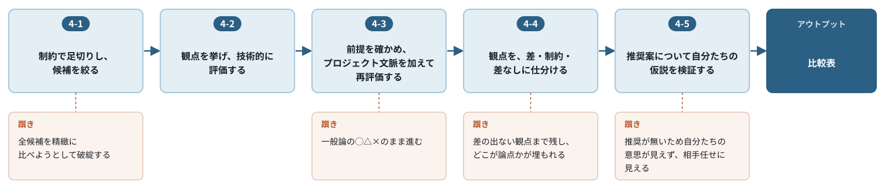

- （4-1）どの制約で案を落としたか、なぜその候補を挙げたか（市場でのデファクトスタンダード、相手の既存資産との親和性、自社の得意領域など）を説明できるようにする（→Appendixの、案の絞り込みパターン）
- （4-2）比較表は案を列に、観点を行にする。観点の方が増減しやすいためである。Pro/Con 形式は同じ観点で比べにくいので使わない
- （4-3）プロジェクトミッション、ユースケース、体制などを照らし合わせると、一般論の差が消えたり残ったりする。精度を上げるのは後回しでよい。足りない前提は仮に決め、そのことを比較表に明示する
- （4-4）文脈を加えて初めて制約になった観点があれば、それを満たさない案を外す。どの観点でもほかの案に劣る案も外す。ほかの候補が消え一択になった場合は、問いを作る材料がないので、相手には結果を報告として伝える
- （4-5）推奨案は、比較表の◯の数では決まらない。どの行を重く見たかが推奨の理由になるので、それを一言で書いておく

::: info 在庫連携の例

データの鮮度、基幹側の改修量、障害が波及する範囲、再送の仕組みで比べる。DB の直接参照は基幹の保守契約で禁止されているので、イベント連携は基幹のパッケージが変更の通知を出せないので外す。夜間一括は、日中の売り越しが今回のきっかけなので外す。残るのは差分ファイル連携と API の2案で、差は鮮度と改修量に出る。

:::

::: tip （4-1）絞り込んだ理由の残し方

技術的な目利きで落とした案は、自分たちの判断として一言で足りる。相手側の制約で落とした案は、「IT 方針で使えるクラウドが限られるため」のように、どの制約で落ちたかを書く。相手が自分の前提と照らして、誤りに気づけるようにするためである。絞り込んで外した案まで比較表に並べる必要はない。

:::

::: tip （4-3）機能では差が出ない選定

クラウドの選定で AWS と GCP を機能で比べると、基本要件はどちらも満たすので、表は◯だらけになる。差が出るのは、組織・運用・事業の文脈を掛け合わせたときである。採用母数と外注先の見つけやすさを取るか、データや AI の立ち上げの速さを取るか。この評価は定性的に埋めるしか無く、一定の割り切りが必要である。

:::

::: tip （4-3）要件が固まるのを待てない場合

要件が固まるのを待てないときは、決まっていないこと自体を前提にする。用途が未定なら、後から要件が変わっても対応できる柔軟性を最優先の観点とし、ほかの観点は優先度を落とす。すべての観点を同列に並べている限り、結論は出ない。「要求事項が確定次第、決定可能です」と返すのは、決められない理由を相手に押し返しているだけである。

:::

# 手続き5 相手が判断できる評価軸に組み替える

ここから相手の目線に切り替える。技術者視点の観点を、相手が判断できる評価軸に組み替える。

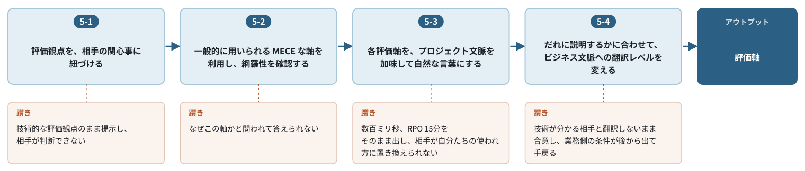

- （5-2）技術的な観点を、相手の関心事、中分類、大分類へと抽象化する。大分類には QCD のような網羅性のある軸を使う（→Appendixの、評価軸に借りる既成の軸）。抽象化すると、コストや法令は相手の価値判断、実装の容易さは自分たちの判断、と分解できる
- （5-3）評価軸の名前は、相手が何を決めるのか、どちらに寄せると何が困るのかが分かるものにする
- （5-4）相手がビジネス部門なら大分類まで、要件定義の担当なら関心事まで上げる

::: info 在庫連携の例

鮮度は、何分前の在庫数で注文を受けてよいか。障害が波及する範囲は、基幹が止まったときにECでも注文を止めてよいか。改修量は、基幹側の改修費と時期。再送の仕組みは、言い直しても相手の関心事にならない。

:::

::: tip 関心事への抽象化の例

| 大分類 | 中分類       | 関心事                   | 相手の言葉に直すと                                           | 技術的な観点                                             |
| :----- | :----------- | :----------------------- | :----------------------------------------------------------- | :------------------------------------------------------- |
| Q      | 性能効率性   | ユーザー体験             | 利用者が操作のたびに遅延を感じないか                         | 応答時間、レイテンシ、拠点からの物理的な距離             |
|        | セキュリティ | データの所在             | 自社のデータを国外で保管してよいか                           | 越境データ移転の制約、監査ログの保持先                   |
|        | 保守性       | 内製化のしやすさ         | 運用にどれだけ手間や高度なスキルが要るか                     | 監視の複雑性、インフラコードの分岐                       |
| C      | 運用費用     | コスト                   | 月々のランニングコスト                                       | インスタンス単価、データ転送量、リザーブド購入による割引 |
| D      | 日程の確実性 | 開発リードタイムのリスク | 必要な機能が揃っていて、作り込みなしで予定どおり構築できるか | サービスの提供状況、新機能が展開されるまでの期間         |

そのままでは相手の関心事に見えない観点も、言い直せることがある。たとえば開発効率性は、納期を気にする相手には、使えるサービスが限られると構築が1〜2週間延びる、と言い直せる。言い直せない観点は、今回の評価軸から外す。

:::

# 手続き6 評価軸から、コンセプト別の選択肢を作る

コンセプト名で、何を優先し何を許容する案かが分かれば、相手は案を選ぶことで重視するビジネス観点を選べる。

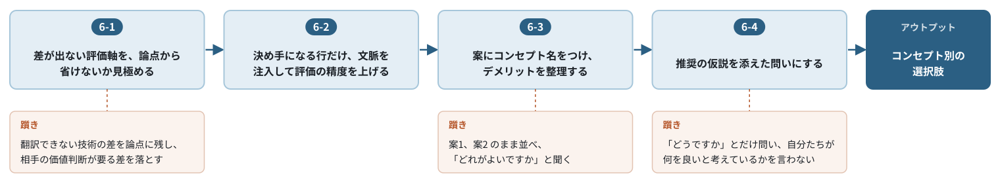

- （6-1）相手が自分の言葉で答えられる形に言い直せない差は、問いにせず、技術で決まる事項として報告する。報告のうち、打合せで伝える価値が高いのは、一択になった理由が相手側の前提によるもの（海外拠点がないからデータは国内保持、など）、相手のその後の業務や運用に影響するもの、後から覆せないものの3つである。それ以外は資料の補足や文書での報告にとどめてよい
- （6-2）手続き4-3 で仮に付けた評価のうち、問いの決め手になる観点だけを、ここで確かめ直す
- （6-3）コンセプト名にはデメリットもあわせて書く。コンセプトは、評価軸を大分類まで上げると見つけやすい（→Appendixの、コンセプト別の選択肢のパターン）。差の大きさは◯△×だけでなく数値で書く。コストを優先しない相手でも、費用が5倍になる案は選べない。相手が到底飲めないデメリットは、重みの問題ではなく隠れた要件の未達なので、選択肢として出す前に確かめる
- （6-4）推奨案を添えて、どちらのコンセプトを取るかを問う。コスト差が小さければ「品質優先A案を推奨するが、このコスト差は許容できるか」、コスト差が大きい割に得られる効果が小さければ「コスト最適化B案を推奨し、セキュリティや性能は別の施策で緩和する形がよいと考えるが、どうか」という問いになる

::: info 在庫連携の例

基幹の改修を抑えて早くリリースする案（15分ほど前の在庫数で注文を受けるので、売り越しが出うる）と、売り越しをなくすリアルタイム案（基幹の改修に◯万円かかり、基幹が止まるとECでも注文できない）を作る。早期リリース案を推奨するが、売り越しを取り寄せで吸収できるか、と問う。再送の仕組みは資料の補足にとどめる。

:::

::: tip （6-1）論点かどうかは、プロジェクトの文脈で変わる

データ主権は一般には重要な観点だが、国内でしか事業をしていない相手なら国内保持しか選ばないため、論点にならない。運用保守性は、稼働後に相手自身が運用を引き継ぐなら相手の価値判断だが、自分たちが運用まで行うなら技術で決まる事項になる。

:::

::: tip （6-1）構成図の合意にも、問いと報告の選り分けが使える

構成図のように多くの要素を1枚に載せる資料でも、全体の合意を直接取ろうとしない。要素ごとに、一般的な構成として示す報告か、相手の価値判断が要る問いかを選り分ける。
クラウドのアカウント構成図なら、開発・検証・本番の環境断面を分けるのは一般的な構成として示すにとどめ、合意を求めるのは監査ログやセキュリティのアカウントを分けるかどうかだけにする。後者は、相手の体制で答えが変わるためである。

:::

::: tip （6-3）バランス案、ハイブリッド案という名前に気をつける

バランス案やハイブリッド案という名前は、どの評価軸も中くらいに見えるため、深く考えずに選ばれやすい。中身が同じでも、何を優先した案かで名前を付け直す。デメリットで言い直すと、さらに冷静に比べられる。

- ❌ バランス型
- ✅ 段階的スモールスタート型（初期にはすべてを作らない）
- ✅ 既存踏襲型（新規要素は加えない）

:::

# 手続き7 説明用のストーリーと伝え方を組み立てる

コンセプト別の選択肢と推奨案を、相手が理解できる流れに組み立てる。

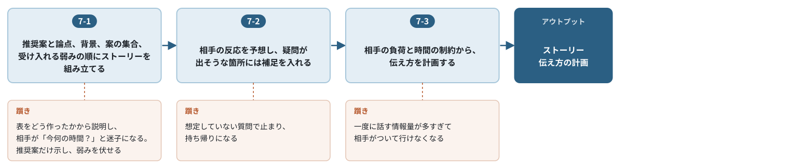

- （7-1）ストーリーの要素ごとに、次を押さえる
  - 冒頭で、何を提案し、何を合意したいかを言い切る。決め手（何を優先するからこの案か）を一言で伝える。推奨案が無いと、判断を丸投げしているように見える
  - 背景には、資料が何を扱うかではなく、次に何をするために今これを決めたいのかを書く。課題の出どころ（だれの要望か、どの検討から出たか）と、検討の前提（相手側の方針、体制、期限など）も書く
  - なぜこの N 個の案なのかを、手続き4-1 で整理した、候補に挙げた理由と外した理由で説明する。比較表は細かく説明せず、どういった観点で差が出たかポイントを伝える
  - 受け入れる弱みは、はっきり書く。ぼかしたまま進めると、リスクの許容度が違う別の利害関係者に後で覆されることがある
- （7-2）相手の上司など、別の利害関係者が指摘しそうな箇所にも、だれがどう気にしそうかを添えて補足できるとなお良い
- （7-3）1回の打合せの時間と、相手が一度に理解できる量に収まるかを見て、何回に分けるかを決める。初手の打合せでは、推奨案のデメリットと緩和策は Appendix に載せる。最初に聞きたいのは、推奨案を見て相手がどういう感想を抱いたかであり、弱みの細部まで話すと情報量が多すぎる

::: info 在庫連携の例

背景には、方式が決まらないと基幹側の改修見積もりが出ず、来期の予算に間に合わないことを書く。受け入れる弱みは15分ほどの遅れによる売り越しで、緩和策は売り越した分を取り寄せで納めること。

:::

::: tip （7-1）背景の例

背景に書くのは、手続き1 で洗い出した作業のうち、この検討事項が決まらないと着手できないものである。

- ❌ 「DWHのアーキテクチャ設計をしたい」
- ✅ 「年明けからDWHの本番環境を構築するため、PoC構築と並行して構築のWBSを作る必要がある。WBSはアーキテクチャの構成要素ごとに作るので、計画の段階で、構成要素を洗い出せる粒度までアーキテクチャを設計したい」

:::

# 手続き8 相手の反応を引き出し、合意する

要望を聞くのではなく仮説を示し、返ってきた反応で、相手の判断基準の見立てを更新する。

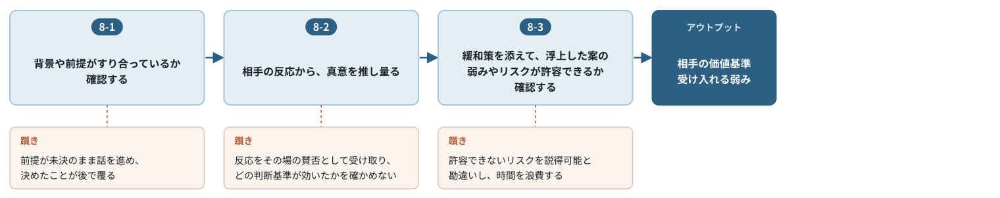

- （8-1）話してみると、前提とした事項がまだ決まっていなかったと分かることがある。そのまま進めて良いことは無いので、その場で前提を確認する時間とするか、「前提を確かめたうえで、別の場を設定させてください」と言って仕切り直す。前提を確かめたら、手続き4-3 に戻って検討をやり直す
- （8-2）返ってきた反応から、相手がどの判断基準で答えているかを推し量る。仮説が当たっていても、相手がなぜ頷いたのかを確かめておくと、次の論点で判断基準を当てやすくなる
- （8-3）推奨案への感想を聞いた後で、Appendix に載せたデメリットと緩和策を示し、推奨案の弱みを許容できるかを確かめる。許容できないときは理由を確かめる。隠れていた制約なら手続き4 に戻って案を落とし、重みの付け方の問題なら手続き5 に戻って評価軸を組み替える。弱みを本当に受け入れたらどうなるか、と想像してもらえるように語ることがコツである

::: info 在庫連携の例

「限定品のセールだけは売り越しが許されない」と返ってくる。隠れていた制約なので手続き4 に戻る。限定品では差分連携が制約を満たさないので、限定品だけ注文時に API で引き当てる案を作り、基幹の改修費を見積もり直す。

:::

::: tip （8-3）緩和策は、4つの型から考える

相手が弱みを許容できないときも、別の型の緩和策なら許容できることがある。

- 回避: 弱みが生じる条件そのものを外す（見込みが立つまで専用の環境を作らない、など）
- 低減: 起こりやすさか、起きたときの影響を小さくする（リハーサルを増やす、戻す手順を決めておく、など）
- 転嫁: 影響を別の主体に移す（運用を自分たちが引き受ける、保守契約で賄う、など）
- 受容: 手を打たずに受け入れ、起きたときの対応だけを決めておく。受け入れる理由も書く

:::

# 手続き9 クロージング

どういう経緯と価値判断で何を決定したかを文書化する。

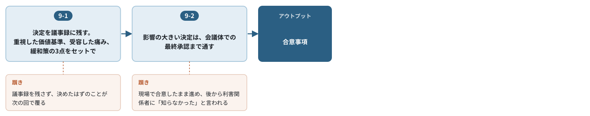

- （9-2）影響の大きい決定は、現場での一次合意に加えて、全体会議などでの最終承認まで通す。どのテーマでどこまで承認を得るかは、相手側の会議体を把握したうえで、本来はプロジェクト計画時に決めておくべきである

::: info 在庫連携の例

通常の商品は15分ごとの差分連携、限定品は注文時に引き当てる、と決まる。重視した点（通常の商品のリリース時期、限定品の売り越し防止）、受け入れた弱み（通常の商品は売り越しが出うる、限定品は基幹の停止中に注文できない）、緩和策を議事録に残す。基幹の改修費を伴うので、情報システム部門を含む会議で承認を得る。

:::

# 失敗パターンと処方箋 {#failure-patterns}

相手の反応から、相手の理解がどの段階で止まったかと、甘かった手続きを推測できる。会議の振り返りにも使える。

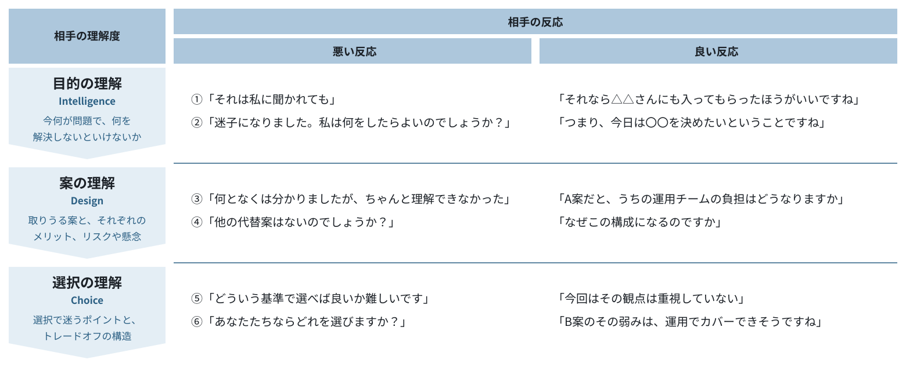
_段階の区分は、サイモンの意思決定モデル（Intelligence → Design → Choice）による_

## ①「それは私に聞かれても」

アカウントの分割単位やリソースの命名規則のような技術的な設計事項を、相手の言葉に直さずにそのまま聞いている。相手には、なぜ自分が問われているのか、そもそも答える必要があるのかが分からない。

- 処方箋: 手続き6-1（報告と問いの切り分け）。答える人が違うなら手続き1-3（答える人の対応付け）
- 良い反応: 「それなら△△さんにも入ってもらったほうがいいですね」。相手が、答えるべき人を自分から挙げており、自分ごとと捉えている

::: info 失敗例: 「データ基盤のレイヤーは3層でよいですか？」と相手に聞いてしまう

- **状況**: データ基盤構築プロジェクトで、メンバーが DWH の論理的なデータ格納層の設計方針を固めたい
- **課題**: 格納層を3層にしてよいか、名前はブロンズ・シルバー・ゴールドでよいかを相手に確認した。相手は判断できず、説明を重ねるほど「よく分からない」という反応になった
- **原因**: 層の数や名前をどう決めても、相手が何かを優先したり諦めたりすることはなく、相手の価値判断に繋がる余地はない。自分たちで決める設計項目を、問いにしていた
- **対応**: 「データ層は3層構成にしました。各層の役割はこうです」と、決めた結果として報告する。レイヤーの分け方と名前は相手が後でデータを探すときに使うので、報告からは省かない

:::

::: tip 「私に聞かれても」と言われる設計事項

表現の言い換えで相手の関心事に届くかどうかで、処方箋が決まる。

| #   | 例                           | 処方箋                                                                                                 |
| :-- | :--------------------------- | :----------------------------------------------------------------------------------------------------- |
| 1   | クラウドアカウントの作成単位 | 請求の分け方、本番を操作する人の範囲、監査ログをだれが見るかに言い直せば問いになる。構成そのものは報告 |
| 2   | コストタグの構造             | 請求をどの軸で見たいかだけを問う。キー名は報告も要らない                                               |
| 3   | リソースの命名規則           | 既存の標準や規程があるかを確認する。なければ方針を報告する                                             |

一つひとつは軽いが、積み重なると時間を奪う人と見られ、信頼を損なう。会議の前に設計項目を相手の判断しやすい観点に翻訳できないか確かめる。

:::

## ②「迷子になりました。私は何をしたらよいのでしょうか？」

なぜ今この話をするのかという背景を伝えないまま、話を進めている。相手は、この場が報告を聞く場なのか何かを決める場なのかが分からず、話が頭に入らない。

- 処方箋: 手続き7-1（背景）
- 良い反応: 「つまり、今日は〇〇を決めたいということですね」。相手が場の目的を自分の言葉で言い直している

## ③「何となくは分かりましたが、ちゃんと理解できなかった」

各案の特徴を、技術的な専門用語を並べて説明し、相手を混乱させている。数百ミリ秒の遅延や RPO 15分を、業務への影響に置き換えずにそのまま話すような場面である。推奨案や計画のリスクを示さず、相手が何を受け入れるのか分からないまま聞いている場合もある。

- 処方箋: 手続き5-2（抽象化）を行い、そもそも技術論を話の中心にしない。リスクを示していない場合は手続き7-1（受け入れる弱み）
- 良い反応: 「A案だと、うちの運用チームの負担はどうなりますか」。相手が案を自分たちの業務に当てはめて考えている

::: info 失敗例: 年内スケジュールのWBSを、リスクや考慮点を示さずに出した

- **状況**: 年明けからの本番構築に向けて、年内に行うアーキテクチャ検討のスコープと想定WBSを相手と合意したい
- **課題**: 相手の反応は「ふーん」だけで、質問が出ないまま合意したように見えた。後の打合せで、年内に終わらない要素や外した要素の話が出たときに「そのリスクは聞いていない」「あのときもっと説明してほしかった」となり、信頼を損なう
- **原因**: この計画の主なリスクや影響度（年内に終わらないおそれがある要素と、遅れたときに本番構築で止まる作業）を示していなかった。そのため相手は、何を許容しなければならないか気づかないままだった
- **対応**: 計画における主なリスクと、そうなったときに後ろ倒しできる要素を添え、そのリスクを許容できるかを相手と合意する。もし、スコープアウトしたものがあれば、「1月以降」の列に要素ごとの理由を付けて並べる

:::

## ④「他の代替案はないのでしょうか？」

「この案でいいですか」と、決め打ちの案だけを示している。マルチテナントのデータ分離で、RLS による論理分離の案だけを持っていき、これでよいかだけを聞くような場面である。相手からは、少なくともアプリケーション側で分離するやり方もあるのでは、と反応された。ほかの案を考えていない場合と、案は考えたが絞った理由を見せていない場合がある。相手は、結論ありきで誘導されていないか、他の手段と比べたうえでの案なのかを不安に感じている。

- 処方箋: 手続き3-1（案出し）。案を絞った場合は手続き4-1（絞った理由）
- 良い反応: 「なぜこの構成になるのですか」。相手が案の並びに納得し、推奨の根拠を確かめに来ている

## ⑤「どういう基準で選べば良いか難しいです」

方式の比較を並べただけで、どの案が何を優先するものかを示していない。◯△×の比較表を見せて「どれにしますか」と聞くような場面である。相手には、コストと品質のどちらを優先するかといった自社の優先度と、表の◯△×がどう結びつくのかが分からない。

- 処方箋: 手続き6-3（コンセプト名とデメリット）
- 良い反応: 「今回はその観点は重視していない」。相手が判断基準を自分から示している。否定的な反応と受け取らなくてよい

## ⑥「あなたたちならどれを選びますか？」

事実を列挙するだけで、提案になっていない。相手は比較の中身を理解したうえで、専門家としての判断を聞いている。

- 処方箋: 手続き6-4（推奨案を添えた問い）。推奨案が未定なら手続き4-5
- 良い反応: 「B案のその弱みは、運用でカバーできそうですね」。相手が推奨案の弱みを理解し、受け入れ方を自分から考えている

::: info 失敗例: 「気になる点があればご指摘ください」と記載してしまう

- **状況**: データ基盤 PoC の週次定例。メンバーは構築の経験は長いが、要件定義への参画は初めて
- **課題**: 主要製品4つを9つの観点で比べた表を作り、各ページのリード文を「◯◯を整理しました。気になる点があればご指摘ください」とした。推したい製品はあったが、資料には書いていなかった
- **原因**: 推奨したい製品を、どの評価軸を重く見たからかという理由とともに言葉にしていなかった。そのため、相手に求めるものが評価軸への同意か、候補の確認か、製品の決定かも決まっていなかった
- **対応**: ◎や×の数では決めず、Snowflake と Databricks の2案に絞る。「運用に人を割かずに済む Snowflake を推奨する。Databricks は非構造データまで扱えるが、使いこなせる人の確保が要る。非構造データは今回の対象に含めるか」と、推奨案を添えて問う

:::

# ケーススタディ

手続き1〜7 で作成した、相手向けの合意形成資料のサンプルを3つ作成した。

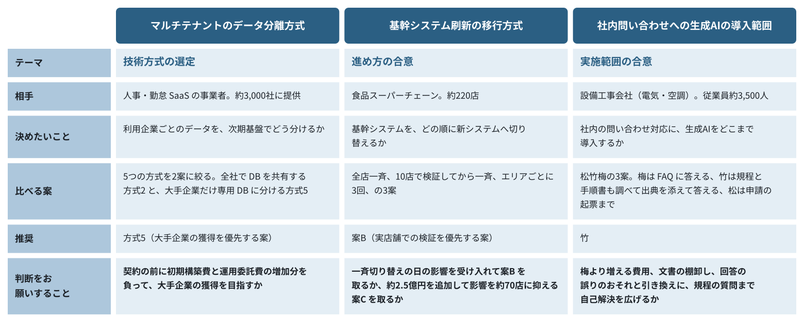

- [マルチテナントのデータ分離方式](#case-multitenant): 技術方式の選定。5つの方式を2案に絞り、物理的な分離を必須とする大手企業の審査に、費用を負って応えるかを問う
- [基幹システム刷新の移行方式](#case-migration): 進め方の合意。1回の切り替えで影響を受ける店舗数を抑える必要があるかを問う
- [社内問い合わせへの生成AIの導入範囲](#case-genai): 実施範囲の合意。松竹梅の3案で、規定の質問まで自己解決を広げるかを問う

失敗例は、[失敗パターンと処方箋](#failure-patterns)に、相手の反応ごとに載せている。

## マルチテナントのデータ分離方式 {#case-multitenant}

### 題材の設定

- 相手: 国内の中堅 BtoB SaaS 事業者。人事・勤怠系の SaaS を約3,000社に提供しており、利用企業の大半は中小企業。合意する先はプロダクト責任者
- 自分たち: 次期基盤（AWS、Aurora PostgreSQL）の設計と、稼働後の運用保守を受託した開発会社
- 現行: 1つの PostgreSQL に全利用企業のデータを格納し、アプリケーションが tenant_id の条件を付けて読み書きしている
- 計画: 年明けからデータ層の詳細設計に入り、2028年4月に稼働する
- きっかけ: ここ1年で従業員1万人を超える大手企業との商談が増えたが、セキュリティチェックシートで他社データとの分離方式を問われ、保留や失注が出ている。チェックシートに回答できるよう、次期基盤でデータの分離を強めることは事業部として決まっている
- 決めたいこと: データの分離の方式。これが決まらないと、データ層の詳細設計を始められない
- 方針（同業で規模が近い SaaS 企業の公開方針から借用）: 大手企業の獲得

### 次期基盤における利用企業データの分け方についてのご相談

#### 背景

大手企業との商談で、セキュリティ要求に対応できず、保留や失注になる例が出ています。物理的な分離を必須とするお客様もいらっしゃいます。

#### 相談事項

次期基盤で、物理的な分離を必須とする大手企業の審査に応じるかどうかと、応じる場合は構成案がいくつかあるため、どれを選ぶかを相談させてください。

データの分け方で DB の構成が変わり、稼働後に専用 DB を足すと作り直しに2名で約3か月（現時点の試算）かかります。そのため、システム構築を担う当社としては、年明けからの DB の詳細設計に入る前の、12月中に決まることが好ましいと考えています。

#### 要件

- 業務要件
  - 大手企業のセキュリティチェックシートの3つの設問（他社のデータと物理的に分離されているか、自社のデータだけを指定した時点に戻せるか、自社専用の暗号鍵を使えるか）に回答できる
  - 他社のデータとの分離を、現行のアプリケーションでの絞り込みより強化する
  - 機能リリースは、利用企業と約束している夜間のメンテナンス枠（週1回、1時間）の中で終える
- システム要件
  - 次期基盤は AWS の Aurora PostgreSQL で構築する
- その他
  - DB の詳細設計は年明けから始める
  - 2028年4月に稼働する
  - 稼働後の運用保守は当社が担う

#### 構成案と推奨

物理的な分離を求める大手企業だけを専用の DB に分ける方式5 をご提案します。それ以外の利用企業（以下、標準）は共有 DB のまま、DB の機能で他社のデータを読めないようにします。理由は次の3つです。

- チェックシートで回答できずにいた3つの設問のすべてに、大手企業向けに回答できるようになる。止まっている商談を進められる。稼働前の商談でも、稼働後は専用 DB で分離すると回答できる
- 大手企業の負荷は専用 DB の中で収まり、標準の利用企業の応答も守れる
- 専用 DB を大手企業の分に絞るので、機能リリースはメンテナンス枠に収まり、基盤費も大手企業の社数分で済む

5つの方式は、全利用企業で1つの DB を共有する共有型（方式1〜3）、利用企業ごとに DB を分ける専用型（方式4）、共有型と専用型を使い分ける組み合わせ型（方式5）の3つの型に分かれます。
物理的な分離は、他社と DB そのものを分けることを指します。同じ DB の中で他社のデータを読めないように制御するものは論理的な分離と呼ばれ、物理的な分離を必須とする審査では認められません。

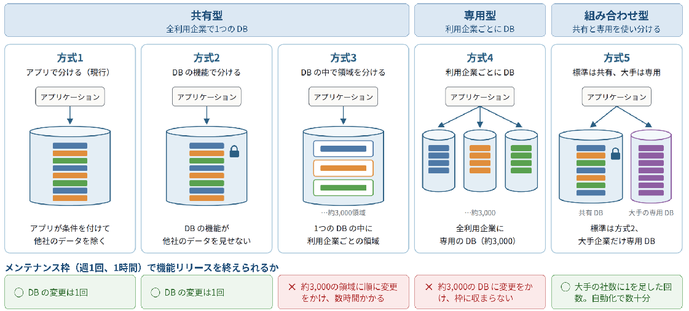
図の色は利用企業を、錠のマークは DB の機能で他社のデータを読めないようにしていることを表します。暗号鍵の意味ではありません。

方式3 と方式4 は、機能リリースのたびに約3,000か所へ変更をかけるため、メンテナンス枠（週1回、1時間）に収まらず、採用できません。残った方式2 と方式5 を、現行の方式1 と比べます。費用の比と工数は、現時点の仮試算です。

【凡例】

- ✅ 問題がない、⚠️ 条件つきで対応できるか負担がある、❌ 事実上対応できない
- グレーの行: 3つの方式で差が出ない観点
- 大手: 物理的な分離を求める大手企業

|        |                |                              | 共有型                                                                                                      |                                                                                       | 組み合わせ型                                                                             |
| :----- | :------------- | :--------------------------- | ----------------------------------------------------------------------------------------------------------- | :------------------------------------------------------------------------------------ | ---------------------------------------------------------------------------------------- |
| 大分類 | 小分類         | 観点                         | 方式1 アプリで分ける（現行）                                                                                | 方式2 DB の機能で分ける                                                               | 方式5 標準は共有、大手は専用                                                             |
|        | 仕組み         | 分離手段                     | 全利用企業のデータを1つの DB に格納し、アプリケーションが読み書きのたびに自社のデータだけに絞る。現行の方式 | 1つの DB を共有するが、DB の機能で他社のデータを読めないようにする                    | 標準の利用企業は方式2、物理的な分離を求める大手企業だけ方式4                             |
|        |                | 実現手段                     | アプリケーションが利用企業の識別番号で絞る                                                                  | DB の機能で他社のデータを読めないようにする（PostgreSQL の行レベルセキュリティ）      | 標準は方式2、大手は方式4                                                                 |
| 品質   | セキュリティ   | 他社のデータの遮断           | ❌ アプリケーションの作りに頼る                                                                             | ✅ DB の機能で遮断                                                                    | ✅ 大手は DB そのもの、標準は DB の機能                                                  |
|        |                | 大手企業の審査: 物理的な分離 | ❌ DB では分離していない                                                                                    | ⚠️ 論理的な分離。物理的な分離を必須とする審査は通らず、第三者認証などで個別に交渉する | ✅ 大手企業は物理的に分離。標準は方式2 と同じ                                            |
|        |                | 大手企業の審査: 専用の暗号鍵 | ❌ 使えない                                                                                                 | ❌ 使えない                                                                           | ✅ 大手企業は使える                                                                      |
|        | 信頼性         | 1社の負荷が他社に及ばないか  | ⚠️ 大手1社の月末の集計などが、全利用企業の応答を遅くしうる                                                  | ⚠️ 同左                                                                               | ✅ 大手の負荷は専用 DB の中で収まり、標準の利用企業にも及ばない                          |
|        | 保守性         | 1社分のデータを戻す時間      | ⚠️ 1営業日以内                                                                                              | ⚠️ 1営業日以内                                                                        | ✅ 大手企業は30分程度。標準は1営業日以内                                                 |
|        |                | 運用する対象の数             | ✅ DB 1つ                                                                                                   | ✅ DB 1つ                                                                             | ⚠️ 共有 DB 1つと大手の数                                                                 |
| 費用   | 初期費用       | 初期構築費                   | ✅ 追加なし                                                                                                 | ✅ 追加なし                                                                           | ⚠️ 方式2 の約1.2倍（専用 DB を自動で用意し更新する仕組みの構築が加わる）。社数によらない |
|        |                | アプリケーションの改修       | ⚠️ 利用企業を識別する仕組みの改修                                                                           | ⚠️ 同左                                                                               | ⚠️ 同左                                                                                  |
|        |                | データの移行                 | ⚠️ 現行から全件を移す                                                                                       | ⚠️ 同左                                                                               | ⚠️ 同左                                                                                  |
|        | 運用費         | 運用委託費                   | ✅ 現行どおり                                                                                               | ✅ 現行どおり                                                                         | ⚠️ 方式2 の約1.1倍。社数によらない                                                       |
|        |                | 月々の基盤費                 | ✅ 現行と同程度                                                                                             | ✅ 現行と同程度                                                                       | ⚠️ 大手1社あたり月約10万円                                                               |
| 納期   | リリースの速さ | 機能リリース時の DB 変更     | ✅ 1回                                                                                                      | ✅ 1回                                                                                | ⚠️ 大手の社数に1を足した回数。自動化により数十分で、メンテナンス枠に収まる               |

残った方式2 と方式5 の違いは、大手企業の扱いだけです。物理的な分離を必須とする審査に応じるかどうかと、稼働時から提供するかで、選ぶ方式が決まります。

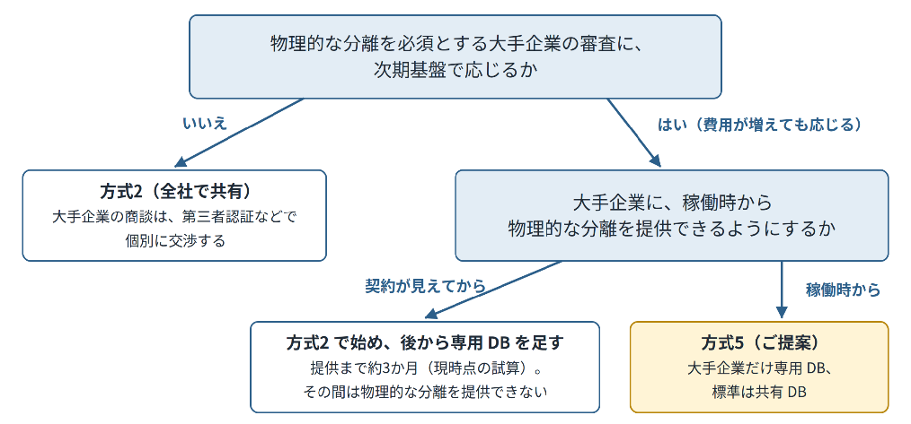

以上から方式5 をご提案します。構築と運用の費用が増えても、物理的な分離を必須とする大手企業の審査に応じる、という方向について、まずはご所感を伺えますか。方式5 のデメリットと緩和策は、Appendix にまとめました。

#### Appendix: 方式5 のデメリットと緩和策

物理的な分離を必須とする審査を通せ、大手企業ごとに性能、復元、暗号鍵を個別に保証できます。一方で次の3つのデメリットがあり、それぞれに緩和策を講じます。

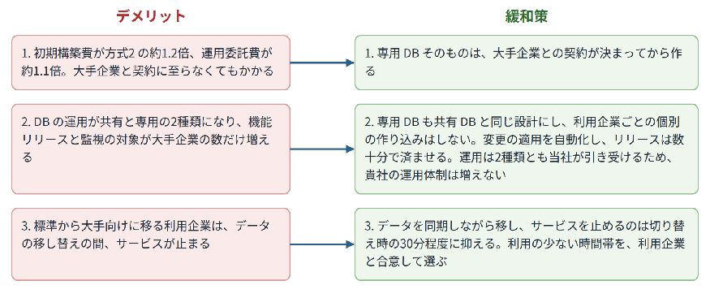

## 基幹システム刷新の移行方式 {#case-migration}

### 題材の設定

- 相手: 国内の中堅食品スーパーチェーン。約220店舗を3エリア（各70店前後）で展開している。合意する先は、情報システム部で基幹システム刷新を担当する課長
- 自分たち: 基幹システム（販売・在庫・発注）刷新を受託した開発会社
- 現行: メインフレーム上の自社開発システム。ホストの保守期限は2029年9月末で、延長保守の可否は未確認
- 計画: 新システムはパッケージとクラウドで構築し、2027年4月から開発、2028年12月に総合テストを終える。移行リハーサルは、どの移行方式でも実施することで合意済み。新旧を並行して動かす期間は、新旧をつなぐ仕組みで足りない部分を本部が手作業で補う
- 決めたいこと: 移行方式。これが決まらないと、移行計画、移行リハーサルの回数、店舗の操作の練習の計画が引けず、2027年度の WBS を確定できない
- 方針（同業で規模が近い2社の公開資料から借用）: 自動発注を広げ、廃棄と欠品を減らす

### 基幹システムの移行方式についてのご相談

#### 背景

現行の基幹システムはホストの保守期限を迎えるため、販売・在庫・発注を新システムへ刷新しています。基幹システムは毎日の自動発注につながっており、切り替えで不具合が出ると、店舗の欠品と廃棄に繋がる懸念があります。

#### 相談事項

システムの切り替えで店舗に及ぶ影響を抑えることと、移行の費用を抑えて保守期限までの余裕を残すことの、バランスを取る必要があります。どの移行方式を選ぶかを相談させてください。

新旧のシステムをつなぐ仕組みは移行方式で開発量が大きく変わり、開発の初期から作り始めます。方式を後から変えるほど作り直しが大きくなるため、システム構築を担う当社としては、2027年度の作業計画を固める前の、今月中に決まることが好ましいと考えています。

#### 要件

- 業務要件
  - 毎日の発注計算（販売の実績から在庫を、在庫から翌日の自動発注を計算する）を止めない
  - 切り替えは閉店後から翌朝の開店までに済ませ、営業を止めない
  - 年末とお盆の前後は切り替えない
- システム要件
  - 保守期限までに切り替えを終える（ホストの保守期限は2029年9月末で、延長保守は見込まない）
- その他
  - 新システムは2028年12月に総合テストを終える
  - 一斉に切り替える場合は、前後1か月ずつ出店と改装の開業を止められる

#### 構成案と推奨

10店で先に3か月検証してから、残り約210店を一斉に切り替える、実店舗検証優先の案B をご提案します。理由は次の2つです。

- 発注の数量がずれる不具合は気づくまで続き、全店の欠品と廃棄に繋がる懸念がある。パイロット（先に10店だけを切り替え、実際の営業で検証すること）で先に見つけて直せば、全店での発注の乱れを1週間程度から1〜2日に抑えられると見込む
- 1回の影響を約70店に抑える案C に比べ、移行の費用は約3分の2（現時点の試算）で済み、保守期限まで4か月の余裕が残る（案C は最終回が保守期限の月にあたる）。レジや発注が止まる不具合は、旧システムへ切り戻せば最大3日程度で収まるため、案C の費用と期限のリスクを負ってまで約70店に抑える必要は小さいと考える

移行方式は、一斉型、組み合わせ型、段階型に分かれます。現行システムを使い続ける現状維持もあわせて、次の5つの案を考えました。

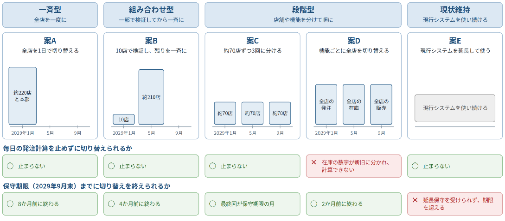

案D は、機能の途中で新旧が分かれると在庫の数字が2か所に分かれ、毎日の発注計算を止めてしまうため、採用できません。案E は、延長保守を受けられず保守期限を超えるため、採用できません。

残った3案を比べます。移行リハーサルは、本番と同じ手順とデータで行う切り替えの予行演習です。移行の費用は、いずれも移行の期間だけにかかります。費用の比と工数は、現時点の仮試算です。

【凡例】

- ✅ 問題がない、⚠️ 条件つきで対応できるか負担がある、❌ 事実上対応できない
- グレーの行: 3案で差が出ない観点

|            |                            | 一斉型                                                                       | 組み合わせ型                                                                                                    | 段階型                                                                                                         |
| :--------- | :------------------------- | :--------------------------------------------------------------------------- | :-------------------------------------------------------------------------------------------------------------- | :------------------------------------------------------------------------------------------------------------- |
| **大分類** | **小分類**                 | **案A 費用・期限優先**                                                       | **案B 実店舗検証優先**                                                                                          | **案C 影響分散優先**                                                                                           |
|            | 切り替えの進め方           | 約220店と本部を1日で切り替える（2029年1月）                                  | 10店を先に切り替えて約4か月営業し、最初の3か月の結果で判定して、残り約210店を一斉に切り替える（2029年1月、5月） | 3エリアを約70店ずつ、4か月おき（各回、3か月の検証と1か月の判定と準備）に3回で切り替える（2029年1月、5月、9月） |
|            | 新旧をつなぐ仕組み         | 不要                                                                         | 商品の情報を新システムへ、売上と在庫を本部会計へ、一方通行で送る                                                | 商品、発注、在庫、売上を新旧で常に一致させる                                                                   |
| 品質       | 営業への影響               | ⚠️ 不具合が出たとき、約220店のレジと発注に影響が及びうる                     | ⚠️ パイロット時は10店、一斉時は約210店                                                                          | ✅ 1回あたり約70店                                                                                             |
|            | 実店舗での検証             | ❌ できない。リハーサルだけで切り替える                                      | ✅ 10店の営業で3か月検証してから広げる                                                                          | ✅ 1回目の約70店で3か月検証してから広げる                                                                      |
|            | 旧システムへ切り戻せる範囲 | ⚠️ 全店単位でしか切り戻せない                                                | ⚠️ パイロット時は10店だけ切り戻せる。一斉時は全店単位                                                           | ✅ 約70店単位で切り戻せる                                                                                      |
|            | 本部の二重作業             | ✅ なし                                                                      | ⚠️ 約4か月、パイロット店とほかの店との間の店間移動と返品を、本部で手作業で補正する                              | ⚠️ 約8か月、商品部が新旧の両方で商品を登録し、発注を確認する                                                   |
|            | 店舗の教育                 | どの案も、全店で同じ量。操作マニュアルと練習用の環境で、切り替え前に練習する |                                                                                                                 |                                                                                                                |
|            | 新システムの機能           | どの案も同じ                                                                 |                                                                                                                 |                                                                                                                |
|            | データ移行の方法           | どの案も、切り替え前に全データを移し、当日はその後の変更分だけを移す         |                                                                                                                 |                                                                                                                |
| 費用       | 移行の費用                 | ✅ 基準                                                                      | ⚠️ 案A の約1.3倍（新旧をつなぐ仕組みの開発、移行リハーサル1回の追加、約4か月の運用支援）                        | ⚠️ 案A の約2倍（新旧を常に一致させる仕組みの開発、移行リハーサル3回の追加、約8か月の運用支援）                 |
|            | 移行後の運用費             | どの案も同じ                                                                 |                                                                                                                 |                                                                                                                |
| 納期       | 保守期限までの余裕         | ✅ 8か月                                                                     | ⚠️ 4か月。一斉切り替えを1か月延期できる                                                                         | ⚠️ 0か月。最終回が保守期限の月                                                                                 |
|            | 移行リハーサルの回数       | 2回                                                                          | 3回（パイロット前1回、一斉前2回）                                                                               | 5回（各回1〜2回）                                                                                              |
|            | 出店と改装の停止           | ✅ 全社で2か月                                                               | ✅ 全社で2か月。パイロットの前後は10店の改装だけ止める                                                          | ⚠️ エリアごとに2か月、全社でのべ6か月                                                                          |

残った3案は、店舗を分けて切り替えることで店舗へのリスクを最小化したいかと、費用を多少増やしてでもシステム移行に起因するリスクを最小化したいかで選び分けます。

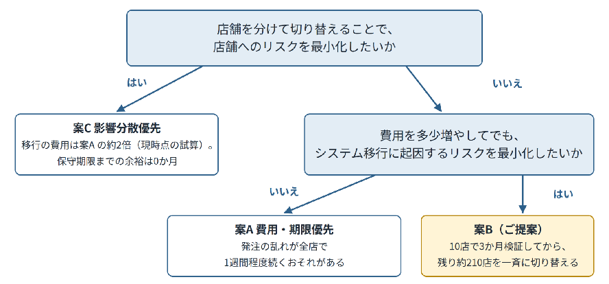

以上から案B をご提案します。移行の費用を増やし保守期限までの余裕をなくしてでも、店舗を分けて切り替えて店舗へのリスクを最小化するなら、案C になります。一斉切り替えとする案B について、まずはご所感を伺えますか。案B のデメリットと緩和策は、Appendix にまとめました。

#### Appendix: 案B のデメリットと緩和策

10店で3か月検証してから広げられ、移行の費用は案C の約3分の2（現時点の試算）で済み、保期限まで4か月の余裕が残ります。一方で次の2つのデメリットがあり、それぞれに緩和策を講じます。

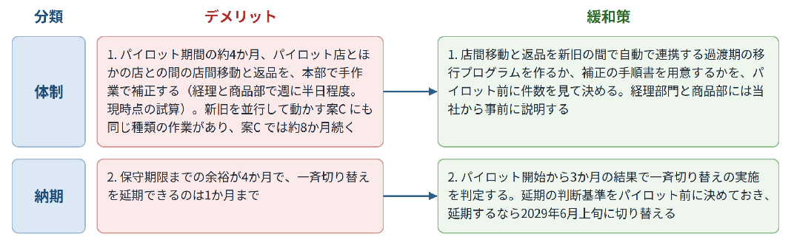

#### Appendix: 案B の日程

切り替えは、月次の締めが新旧にまたがらないよう、月初の閑散日に実施します。パイロットは、年始の繁忙が明けた後に始めます。

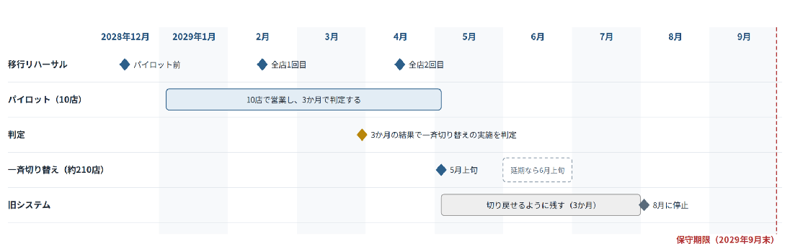

## 社内問い合わせへの生成AIの導入範囲 {#case-genai}

### 題材の設定

- 相手: 国内の中堅の設備工事会社（電気・空調の設備工事。従業員約3,500人）。全国の支店と約300の作業所に社員が分散している。合意する先は、情報システム部で社内問い合わせの改善を担当する課長
- 自分たち: 相手の情報システム部から、社内問い合わせへの生成AIの導入を受託する予定の開発会社。構築と稼働後の運用保守を担う
- 現行: 情報システム部のヘルプデスク（外部委託を含む）と、総務部・人事部の窓口が、メール・電話・Teams で社内の問い合わせを受けている。件数は月約4,000件で、受付は平日9時〜18時。社内ポータルに FAQ 約400問があるが、探しにくく利用が少ない
- 計画: DX戦略で、社内問い合わせを生成AIで効率化することが決まっている。稼働は2027年10月を目標とする
- きっかけ: 来年度予算の申請が2027年1月中旬に締め切られる。範囲によって初期構築費が大きく変わるため、12月の定例で範囲を決めたい
- 決めたいこと: 生成AIで社内問い合わせのどこまでに対応するか
- 方針（同業で規模が近い2社の公開資料から借用）: 問い合わせ対応を生成AIで効率化し、窓口の工数と社員の待ち時間を減らす

### 社内問い合わせへの生成AIの導入範囲についてのご相談

#### 背景

社内の問い合わせは、作業所の始業前や夜間に届くものが多く、受付時間外に届いた問い合わせの回答は翌営業日になっています。DX戦略で、社内問い合わせを生成AIで効率化することが決まっています。

#### 相談事項

規程や手順書を読めば答えられる質問まで、社員が窓口を介さずに解決できるようにするかどうかと、広げる場合は対応する範囲がいくつかあるため、どれを選ぶかを相談させてください。

対応する範囲によって初期構築費が大きく変わり、範囲を後から広げると稼働が1年遅れます。そのため、来年度予算の申請に間に合わせるには、申請前の12月中に決まることが好ましいと考えています。

#### 要件

- 業務要件
  - 社内問い合わせを生成AIで効率化する（DX戦略で決定済み）
  - 受付時間外の問い合わせにも答える
  - 作業所からもスマートフォンの Teams で問い合わせられる
- システム要件
  - 生成AIは、全社で利用している Microsoft 365 と Azure の契約の中で国内で動くものを使い、入力した内容を学習に使わせない
- その他
  - 来年度予算の申請は2027年1月中旬に締め切られ、年度の途中では予算を追加できない
  - 2027年10月に稼働する
  - 全社員への汎用の生成AIの展開は、全社の生成AI活用として別に検討しており、今回の範囲に含めない

#### 構成案と推奨

社内問い合わせに生成AIで対応する範囲を、広い順に松・竹・梅の3段階で比べ、竹をご提案します。竹は、FAQ に加えて社内規程と手順書を調べて答えます。理由は次の2つです。

- 問い合わせの約4割に、受付時間外でもその場で答えられる。窓口の対応工数を月約500時間減らせる（梅は月約140時間）。差は、1件あたり約30分かかる規程の質問の分
- 申請の起票は後から追加でき、効果を稼働後の利用状況で確かめてから判断できる

窓口の直近6か月の記録を当社が分類すると、問い合わせは、答えるのに何が要るかで次の4つに分かれます。窓口の対応工数は、合わせて月約1,430時間です。

松・竹・梅は、社員が直接使う生成AIが、このうちどこまでに対応するかの違いです。

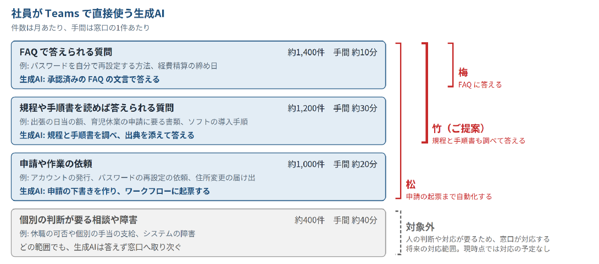

松・竹・梅を比べます。費用の比と工数は、現時点の仮試算です。

【凡例】

- ✅ 問題がない、⚠️ 条件つきで対応できるか負担がある、❌ 事実上対応できない
- グレーの行: 3つの範囲で差が出ない観点

| 大分類 | 小分類       | 観点                                          | 松 申請の起票まで自動化する                                                                                                                                                | 竹 規程と手順書も調べて答える                                                                        | 梅 FAQ に答える                                                              |
| :----- | :----------- | :-------------------------------------------- | :------------------------------------------------------------------------------------------------------------------------------------------------------------------------- | :--------------------------------------------------------------------------------------------------- | :--------------------------------------------------------------------------- |
|        | 仕組み       | 生成AIが対応する範囲                          | 竹に加え、申請の下書きを作ってワークフローに起票する。パスワードの再設定とアカウントの発行は、本人を確かめたうえで自動で済ませる。その他の申請の処理は現行どおり窓口が担う | 梅に加え、全社員に公開している規程と手順書 約2,200文書から関係する箇所を探し、出典を添えて答える     | 承認済みの FAQ 約400問から答えを探して答える。FAQ に無い質問は窓口へ取り次ぐ |
| 品質   | 使いやすさ   | 自己解決できる問い合わせ                      | ✅ 月約2,260件、約6割                                                                                                                                                      | ✅ 月約1,560件、約4割                                                                                | ⚠️ 月約840件、全体の約2割                                                    |
|        |              | 受付時間外の問い合わせ（全体の約3割）への対応 | ✅ 申請の起票まで即時                                                                                                                                                      | ✅ 規程の質問まで即答                                                                                | ⚠️ FAQ の範囲だけ即答                                                        |
|        |              | 使う場所                                      | ✅ Teams（パソコン、スマートフォン）                                                                                                                                       | ✅ 同左                                                                                              | ✅ 同左                                                                      |
|        | 正確さ       | 回答の誤り                                    | ⚠️ 竹と同じ。申請の内容の誤りは、本人の確認と承認で止める                                                                                                                  | ⚠️ 規程の質問への回答の1割強に誤りや不足が出るおそれがある。出典を添え、社員が確かめられるようにする | ✅ 承認済みの FAQ の文言で答える                                             |
|        |              | 改定への追従                                  | ✅ 竹と同じ                                                                                                                                                                | ✅ 規程を差し替えれば回答に反映される                                                                | ⚠️ FAQ を人が直す                                                            |
|        | セキュリティ | 見せてはいけない文書が回答に出るおそれ        | ⚠️ 竹と同じ。加えて、生成AIにアカウントを操作する権限を与える                                                                                                              | ⚠️ 全社員に公開している文書に限る。公開範囲の設定を誤った文書があれば、回答に出るおそれがある        | ✅ FAQ だけを使う                                                            |
|        |              | 生成AIに与える権限                            | ⚠️ アカウントの操作を含む                                                                                                                                                  | ✅ 読み取りだけ                                                                                      | ✅ 読み取りだけ                                                              |
|        |              | 入力した内容の扱い                            | ✅ 国内の基盤で処理し、学習に使われない                                                                                                                                    | ✅ 同左                                                                                              | ✅ 同左                                                                      |
| 費用   | 初期費用     | 初期構築費                                    | ⚠️ 梅の約9倍（竹に加え、ワークフローとアカウント管理との連携）                                                                                                             | ⚠️ 梅の約3倍（文書の取り込み、関係する箇所を探して答える仕組み、回答の正しさの評価）                 | ✅ 基準                                                                      |
|        | 運用費       | 運用費（基盤の利用料と運用保守）              | ⚠️ 梅の約6倍                                                                                                                                                               | ⚠️ 梅の約3倍                                                                                         | ✅ 基準                                                                      |
|        |              | 基盤の利用料                                  | ⚠️ 年約600万円                                                                                                                                                             | ✅ 年約300万円                                                                                       | ✅ 年約100万円                                                               |
|        | 効果         | 減らせる窓口の対応工数                        | ✅ 月約620時間（申請は案内と差し戻しの手間 1件約10分を減らす）                                                                                                             | ✅ 月約500時間                                                                                       | ⚠️ 月約140時間                                                               |
|        | 貴社の作業   | 稼働までに貴社が担う作業                      | ⚠️ 竹に加えて、申請 約20種類の手順の整理と、ワークフローの改修の調整 約6か月                                                                                               | ⚠️ 梅に加えて、総務部・人事部による文書の棚卸し 約3か月                                              | ✅ FAQ の見直し 約1か月                                                      |
|        |              | 稼働後の窓口の運用                            | ⚠️ 取り次がれた問い合わせに対応                                                                                                                                            | ⚠️ 同左                                                                                              | ⚠️ 同左                                                                      |
| 納期   | 稼働時期     | 稼働時期                                      | ⚠️ 2028年7月                                                                                                                                                               | ⚠️ FAQ の部分は2027年7月、規程の部分は2027年10月                                                     | ✅ 2027年7月                                                                 |

竹の費用のうち、初期構築費と運用保守費は利用の多さによらずかかり、基盤の利用料 年約300万円は問い合わせの件数に比例します。減らせる工数は、FAQ で答えられる質問と規程の質問のそれぞれ約6割を、自己解決できる想定で算出しました（当社が他社で導入した同種の仕組みで、窓口への再度の問い合わせが無かった割合）。

範囲を広げるほど自己解決できる問い合わせが増え、費用と回答の誤りのおそれも増えます。規程の質問まで広げるかと、申請の起票の自動化まで今回の予算に含めるかで、選ぶ範囲が決まります。

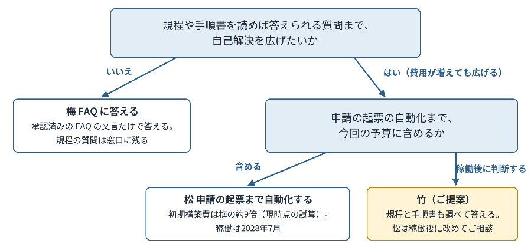

以上から竹をご提案します。初期構築費と運用費が梅の約3倍（現時点の試算）になり、文書の棚卸し 約3か月（現時点の試算）が加わります。これらと引き換えに規程の質問まで自己解決を広げる、という方向について、まずはご所感を伺えますか。竹のデメリットと緩和策は、Appendix にまとめました。

#### Appendix: 竹のデメリットと緩和策

規程の質問にも答え、窓口の対応工数を月約500時間減らせます。一方で次の4つのデメリットがあり、それぞれに緩和策を講じます。

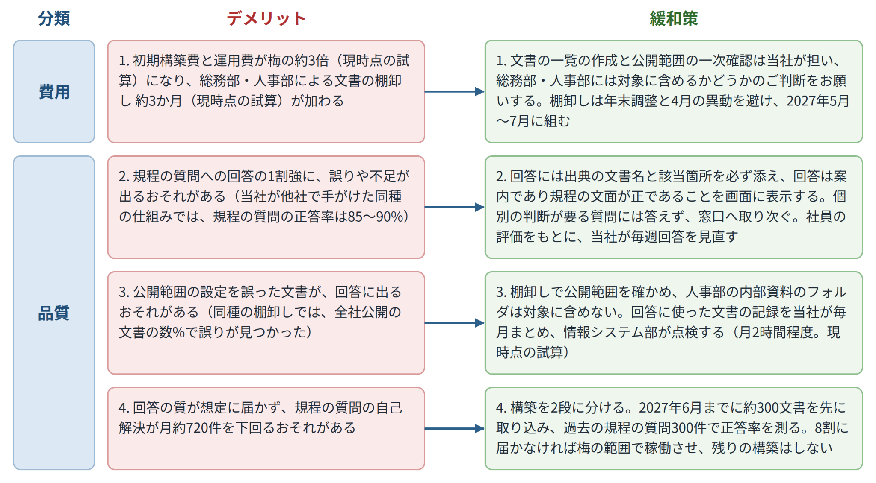

#### Appendix: 竹で生成AIが答える質問と、窓口へ取り次ぐ質問

| 分類             | 区分                               | 竹での扱い                                                       |
| :--------------- | :--------------------------------- | :--------------------------------------------------------------- |
| 生成AIが答える   | FAQ で答えられる質問               | 生成AIが FAQ の文言で答える                                      |
|                  | 規程や手順書を読めば答えられる質問 | 生成AIが出典を添えて答える                                       |
| 生成AIが案内する | 申請や作業の依頼                   | 申請の手順と申請画面を案内する。手続きは現行どおり窓口が対応する |
| 窓口へ取り次ぐ   | 個別の判断が要る相談               | 答えず、総務部・人事部の窓口へ取り次ぐ                           |
|                  | 障害                               | 答えず、情報システム部のヘルプデスクへ取り次ぐ                   |

# ベテランの視点

## ベテランはどう省いているか

技術評価と合意形成を2つの山とみると、メンバーとベテランでは登る順番が違う。メンバーは技術評価の山を登ってから、その評価を相手の評価軸に翻訳して合意形成の山へ向かう。ベテランは先に合意形成の山を登り、相手がどこなら頷くかを見立ててから、なぜそう言えるかを技術評価の山で後から固める。

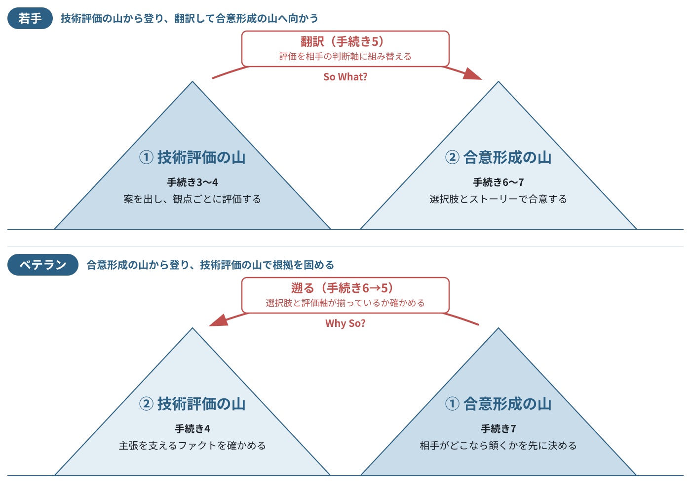
_要求工学のツインピークスモデルを、技術評価と合意形成の2つの山に当てはめた_

WBS 計画から関わる場合と、途中から参画している場合で動きが変わる。
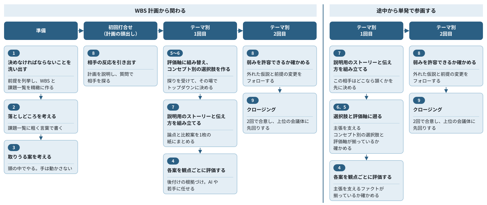

WBS 計画から関わる側の詳細を示す。カッコ内は対応する手続きの番号である。

- （1）～（3）前提と必達の要求を列挙し、想定アウトプットから逆算して WBS と課題一覧を作る。課題ごとに論点、仮説、落としどころ、相手が気にしそうな箇所、だれが決められそうかを書き込み、書き込みが多い課題だけ資料にする。相手側の担当者が異なる課題は会議体を分ける
- （8）初回: 事前に、自分たちが分かっていないことを質問として洗い出す。初回は打合せ計画を説明し、影響の大きい質問で相手の価値判断、組織、キーマンを探る。合意を求めるのは、検討の進め方と打合せ計画までにとどめる。本音の判断基準を探るのに、他社の事例を当てて反応を見る人もいる
- （5〜6）初回の探りでトップダウンに評価軸を決め、その大分類からコンセプト別の選択肢を作る。選択肢は事前に作り込まず、その場で組み立てることもある
- （7）資料はディスカッションペーパー1枚にとどめる。論点と比較案を載せ、流れは口頭で補う
- （4）推奨案を先に決め、比較表はその検証に使う。作成は AI やメンバーに任せる
- （8）2回目以降: 外れた仮説と前提の変更を反映し、推奨案に残る弱みを緩和策込みで許容できるか確かめる
- （9）各テーマ2回での合意を目安にする人もいる。合意できないものはチケットにし、期限と確認先を相手と決める。クリティカルパスなら3回目を設け、遅延への対応を推奨案として示して合意する。影響の大きい決定は、経営層へ先にインプットしておく

::: warning 手続きを省けるのは、省いた分を信頼で埋められる人だけ

早い段階で筋のよい質問をして信頼を得ておくと、後の合意が進めやすい。仮決めで先に進めて後で回収する動きは、信頼のないうちにやると、後で覆らないかと相手を不安にさせる。省くかどうかは、力量、テーマの重要性、相手がその進め方を受け入れるかで決まる。

:::

## ジャブで関心事を引き出す

会議1回で全部を決めることは、ベテランでも容易ではない。そのため、作成途中で相手に見せ、反応を得ながら進める。本書ではこれをジャブと呼ぶ。相手にとっても、事前に見ておけば考える時間が取れ、社内の有識者に聞くこともできる。

1. 整理の途中だと伝える。「いま比較を整理している途中で」前置きして反応を見る
2. 詳細は調査中であっても、仮の見立てを出す。「この軸だとこれが優先になりそう」と、手続き2 の落としどころと手続き5 の評価軸を仮のまま示す。白紙で「何を重視されますか」と聞くと相手の負担になる。当たりに自信が持てないときは、定例とは別に10〜15分のヒアリングを設けてもよい。仮説を持っていき、この相手とは話す価値がある、と思われて初めて本音が出る
3. 気にしていること、足りない情報を聞く。「他に気にしていることはあるか」「関連する資料を受領できるか」と、定例の冒頭や雑談で、前提の確認として聞く。正規の議題にすると相手は付加価値を感じにくいため、できれば避ける

## 合意は資料を出した後の会話で決まる

ケーススタディは、初回打合せの想定で作成している。説明資料が扱うのは、技術判断と、それを従属させる1段上の相手の価値判断までである。その上位にある目指す姿は、資料では仮に定めている。メンバーは、資料を出せばその内容を議論すると捉えがちである。実際には、資料を足場にした会話の中で、相手側の担当者同士が話し始めたり、「それなら上に確かめましょう」となることもある。この脱線は、目指す姿から判断軸を見つめ直す機会になる。そのため、ベテランは打合せの途中で、「もともと、やりたいことは何だったんでしょうか？」と問いかけ、相手が改めて考える余地を作り、より本質に迫る議論に話を持っていくこともある。

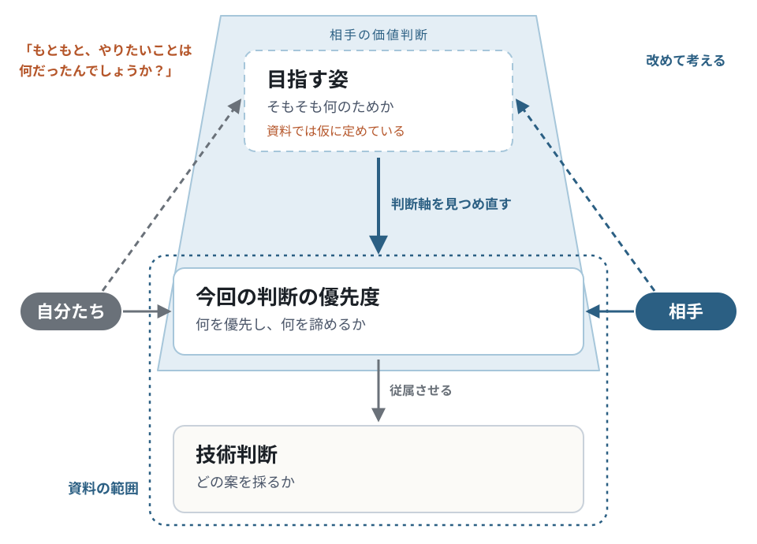
::: info 生成AIのケースの例

DX 戦略が決めているのは、生成AIを使うことだけである。効率化、人員削減、サービスレベルの向上、負荷の軽減のどれを優先するかは、相手もまだ決めきれていない。資料の整理を足場に「そもそもこれは、どういう経緯で決まったんでしたっけ」と問い、相手が目指す姿を改めて考えてもらう。

:::

## 相手が自分で考えたという納得感を重視するとき

業務やUIの仕様のように、相手が自分で考えることを重視する状況では、1回目に推奨案を出し切らない進め方も有効である。1回目は前提と課題、基礎的な案だけを示し、相手の意見を聞く。推奨案は、この時点で手元に固めておく。2回目に、そのコメントを踏まえて練り直した案として推奨案を示す。自分の意見が反映された案なので、相手は納得感をもって自身の利害関係者に報告しやすい。

# レビュー技術

レビューの役割は、資料の良し悪しを判定することではなく、メンバーが手続きのどこで詰まっているかを見極め、次に何を考えればよいかを伝えることである。

## レビューでの見極め方

レビューを始める前に、メンバーの成果物がどの段階にあるかを見極める。

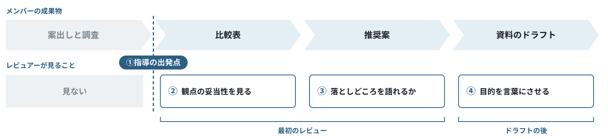

### ①比較表が出てきたところが、指導の出発点

最初のレビューは、仮の比較表と推奨案ができた時点で行う。そこまでは経験の浅いメンバーでも AI を使って作れ、指導が要るのはその先だからである。

### ②比較表のレビューでは、中身より観点の妥当性を見る

初期段階では、◯△×を精緻に埋めさせず、観点が妥当か、相手の関心事に合っているかを先に確かめる。

- 評価を正確に埋めるには調査や机上/実機検証が要り、AI を使っても時間がかかる。観点がずれていると、その分が手戻りになる
- 仮の◯△×なら、一部が空白でも、優劣の傾向と、どこが論点になりそうかは掴める

観点を分類する軸（QCD や品質特性など）は、最初はレビュアーが示す。繰り返すうちに、メンバーが自分で分類できるようになる。

### ③落としどころを語れるかで見極める

観点を確かめたら、「なぜこの案を推奨するのか」と聞く。「要件が◯◯だと仮定すれば、△△の観点でこの案がよい」と自分の言葉で言えればよい。言えなければ、闇雲に進めている懸念がある。相手に持っていく前に、チーム内で仮説を立て直す。

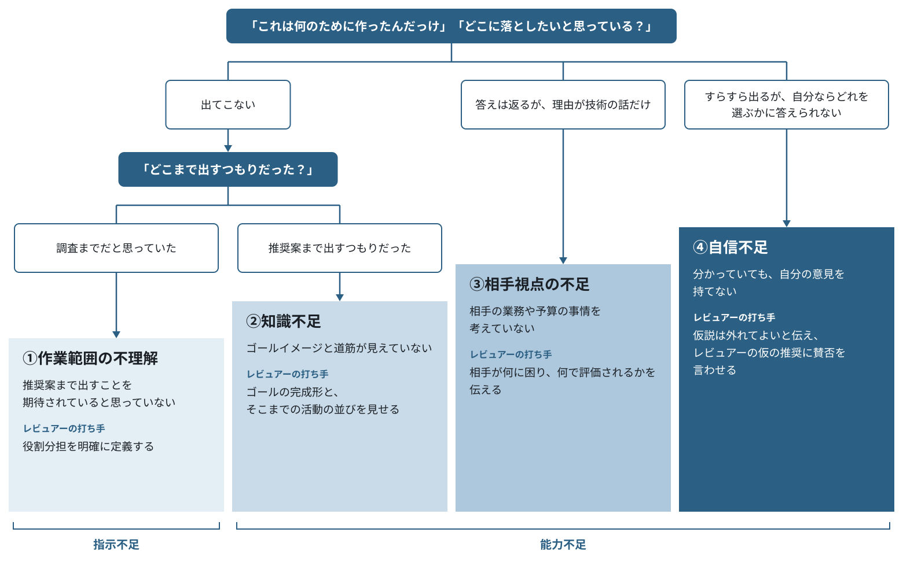
_覚悟の問題に見えるもの_

図の①は、役割分担が曖昧なプロジェクト初期に起きやすい。図の②と③は、進め方の指導で解ける。図の④は、道筋も相手の事情も見えているのに、自分のスタンスを決められない状態である。自分ならどれを、何を理由に選ぶかを言わせる。

### ④目的は、ドラフトの後で言葉にさせる

メンバーはまず中身を作るので、リード文が「違和感はあるか」「Aで進めてよいか」という作成者目線になるのは自然である。ドラフトを見た後で、目的を言葉にし直すステップを設ける。

1. ドラフトを見て、相手からどんな質問や反論が出そうか、どこで合意が詰まりそうかを想像する
2. 該当ページで相手に求めるアクションを、5形式（→Appendixの、相手へのコミュニケーションは、5形式に分類できる）から選び直す
3. 定義した目的に合わせて、ページ構成やメッセージラインを組み直す

最低でも、ページごとに「このページの意図は◯◯です」と一文を付箋で書いてもらう。非機能要件の基礎数値を集めるページなら、「見積もりの費用計算、非機能のテストケース、監視設計に使うため」と書いてあれば、相手はそのページの位置づけと重要度が分かる。

## アンチパターン

レビュアーが言いがちだが、メンバーの手を止めてしまう声かけを挙げる。①②は特定の段階で、③〜⑤はどの段階でも出やすい。

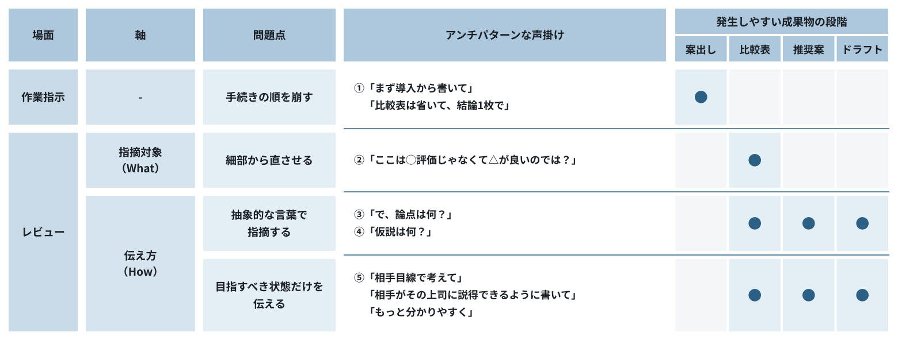

### ①「まず導入から書いて」「比較表は作らずに、結論1枚でまず作って」

どちらも、ベテランが無意識にやっていることをそのまま指導に持ち込んでいる。導入は中身の解像度が上がってから書けるもので、先に書かせると、書き出した仮説に縛られて中身が進まなくなる。比較表を省けるのは、省いた分を知見と相手との信頼で補える人だけである（→ベテランの視点の、手続きを省けるのは、省いた分を信頼で埋められる人だけ）。

9つの手続きを順に踏ませる。まず手を動かせる具体を作らせ、そこから何が論点になるかを見極めていく作業に付き合う。

### ②「ここは◯評価じゃなくて△が良いのでは？」

細部の採点を直させると、メンバーは表を埋める作業に没頭し、相手への翻訳に頭が回らなくなる（→レビューでの見極め方の、②比較表のレビューでは、中身より観点の妥当性を見る）。

「◯△×は仮でいい。この表を相手が読める大分類に束ねると何になる？」と、手続き5 の翻訳へ視点を上げる。明らかに間違っている部分はさっと伝えるか非同期でコメントする。

関連する手続き: 手続き4-2、5

### ③「で、論点は何？」と抽象的に詰める

論点という言葉は抽象度が高く、慣れないメンバーは手が止まる。論点は案を比べた差から生まれるので、手前の整理がないまま問うても出てこない。

「案は何通りある？」「それぞれで何が変わる？」と、前提となる事実確認から問う。比較表ができていれば、「この表で、相手の価値判断が必要なのはどの行？」「それが決まらないと、自分たちの作業は止まる？」「それが決まると、だれがどう嬉しい？」と問い、相手に問うものと報告で済むものを分けさせる。

関連する手続き: 手続き3、4、6

### ④決断を促そうとして「仮説は何？」と聞く

「仮説」は抽象度が高い言葉で、何を仮説と呼ぶかの基準が無い。本人なりの考えはあるので、「それは仮説ではない」「仮説です」の押し問答になりやすい。「仮説」という言葉は使わず、何についての考えを聞きたいのかを、資料の状況に合わせて具体的に問う。

- 作成途中なら、「ここまでよく作ったね。この後どうしたい？」と受け止めてから問う
- 前提が分からず手が止まっているなら、「どういう前提で作ろうとしている？」と問う
- 資料ができていれば、「打合せ当日、相手にどう説明する？」と問う。説明の場面を考えると、指摘しなくても自分から直す箇所を挙げてくる
- 懸念が見えているなら、「その懸念に対して、どういうストーリーなら納得させられると思った？」と問う

相手の気持ちの仮説すら立たない状態なら、過去プロジェクトのお手本を渡す。

関連する手続き: 手続き2-3

### ⑤「相手目線で考えて」「相手がその上司を説得できるように書いて」「もっと分かりやすく」

いずれも目指す状態であって、考え方ではない。相手の評価軸への翻訳は経験が要る部分で、意識づけでは改善幅は小さい。足りないのが、目的、評価軸、コンセプト別の選択肢、推奨案、ストーリーのどれなのかを特定して伝える。

関連する手続き: 手続き5、6-3、7-1

# Appendix

## 合意形成の手続き

### 一般的な合意形成術との関係

ハーバード流交渉術の4原則は、「人と問題を分ける」「立場ではなく利害に注目する」「複数の選択肢を用意する」「客観的な基準を使う」である。本書の手続きはこれを概ね踏襲しており、技術を相手の言葉に翻訳する手続きを追加している。
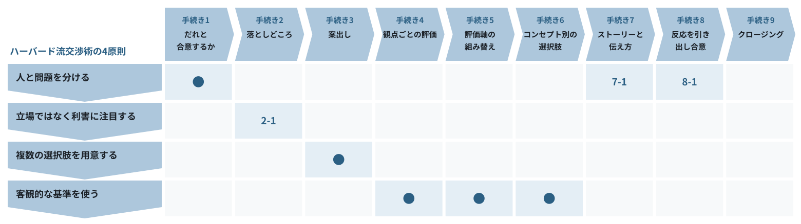

## 手続き4 各案を観点ごとに評価する

### 案の絞り込みパターン

洗い出した案を絞り込む理由は、制約、要件の未達、劣位に3分類できる。

| 分類       | パターン                    | 説明                                                                                                                                         | 絞り込む場合の相手への伝え方の例                                                                 |
| :--------- | :-------------------------- | :------------------------------------------------------------------------------------------------------------------------------------------- | :----------------------------------------------------------------------------------------------- |
| 制約       | 技術制約                    | 相手の既存環境に載らないもの、既存システムとつながらないもの、自分たちの技術方針（サポート終了が近い製品は採らない、など）に反するものを外す | 「今の閉域網でつながるのは AWS だけなので、ほかのクラウドは外します」                            |
|            | ビジネス制約                | IT 方針、法規制、契約に反するものを外す                                                                                                      | 「業界のガイドラインでデータを国内で保管する必要があるため、国内リージョンのない製品は外します」 |
| 要件の未達 | 機能要件                    | 今回の用途に要る機能（データ基盤なら、アクセス権限の管理やデータカタログ）を持たないものを外す                                               |                                                                                                  |
|            | 非機能要件 （性能・拡張性） | 今のデータ量や利用者数で基準を満たさないものと、増えたときに持ちこたえないものを外す                                                         |                                                                                                  |
|            | 非機能要件 （移植性）       | 用途が固まらない段階で、特定の技術にロックインされ、後から載せ替えにくいものを外す                                                           |                                                                                                  |
|            | 非機能要件 （保守性）       | 標準的な運用プロセスに乗らないもの、作り込みが要るもの、扱える人を確保しにくいものを外す                                                     |                                                                                                  |
| 劣位       | 下位互換                    | どの観点でも、ほかの候補と同等か劣るものを選択肢から外す                                                                                     |                                                                                                  |

## 手続き5 相手が判断できる評価軸に組み替える

### 評価軸に借りる既成の軸

システム構築のプロジェクトでは、大分類に QCD を借りると収まりがよい。Q の中身は ISO/IEC 25010 の品質特性を参考にできる。積み上げで作った評価軸だけだと、「なぜこの軸なのか」「観点に抜けはないか」と問われやすい。広く受け入れられた分類を起点にすれば、相手の納得を得やすく、自分たちも観点の抜けを防げる。

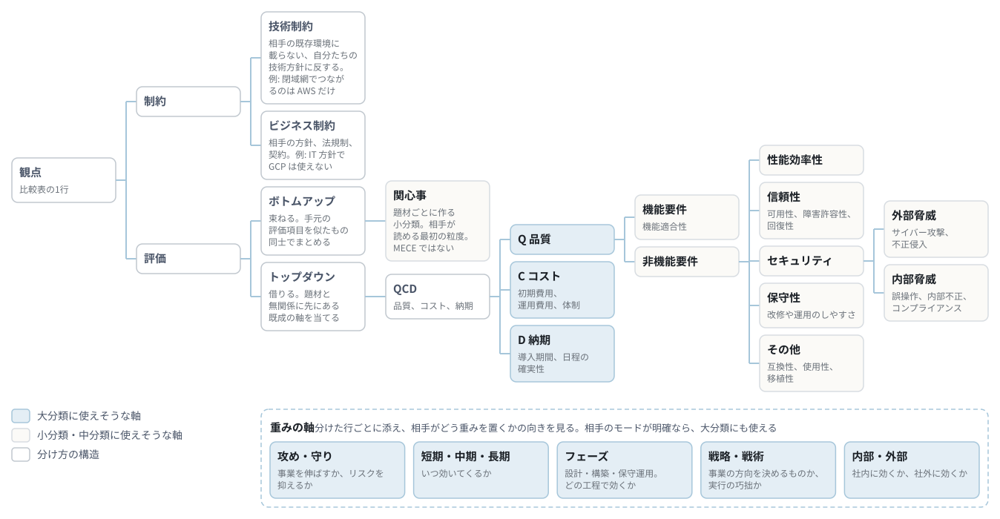

攻め・守りを大分類にするときは、性能や開発の速さを攻めの側、セキュリティや可用性を守りの側に振り分ける。相手が攻めと守りのどちらを重視するかで判断しようとしているときに使う。どの軸を借りるかは、相手に何を問いたいかで選ぶ。

## 手続き6 評価軸から、コンセプト別の選択肢を作る

### 相手へのコミュニケーションは、5形式に分類できる

比較表の観点は、制約と評価に分かれる。同じセキュリティ項目でも、必須なら制約、充実度を比べるなら評価である。制約は案を候補から外すのに使う。外す条件そのものに相手の同意が要るときだけ、基準への同意として問う。評価は、案同士で差が出れば論点になり、優先度の選択か弱みの許容として問う。手続き6 のコンセプト別の選択肢は、このうち優先度の選択の形で問う。

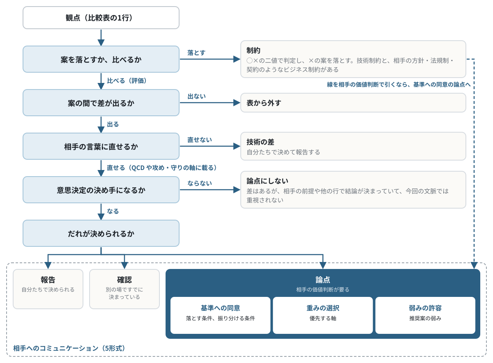

形式ごとに、資料に必要な記載内容が異なる。

| 区分                        | 形式         | 相手に求めること                                                                       | 利用条件                                                               | 資料に必要な記載内容                                                                |
| :-------------------------- | :----------- | :------------------------------------------------------------------------------------- | :--------------------------------------------------------------------- | :---------------------------------------------------------------------------------- |
| 相手の価値判断が不要        | 報告         | 決めた内容を把握してもらう                                                             | 相手の価値判断は要らない。自分たちで決めた                             | 決めた内容と、その役割・採用理由、相手側の作業や運用への影響の有無                  |
|                             | 確認         | 想定が合っているかの確認                                                               | 相手から事実として回答がある。または別の場ですでに決まっている         | 自分たちの想定と、その根拠                                                          |
| 相手の価値判断が要る / 相談 | 基準への同意 | 案を落とす条件や、振り分ける条件に同意を得る。結果は条件から決まり、相手は何も諦めない | 候補が多く予選が要る。または、個別の判断をルールで束ねる               | 基準と、それを適用した結果 （→手続き4-1）                                           |
|                             | 優先度の選択 | 残った案のトレードオフのうち、何を優先し何を諦めるかを、推奨案を添えて合意する         | トレードオフの構造が出ていて、案ごとにどの重み付けなら選ぶかが言える。 | 推奨案と、コンセプト名を付けた案ごとのメリット・デメリット（→手続き6-3、手続き6-4） |
|                             | 弱みの許容   | 推奨案に残る弱みを、緩和策込みで許容できるか確認する                                   | 推奨案が1つに絞れていて、弱みが許容できる範囲に収まっている            | 弱みと緩和策の対 （→手続き8）                                                       |

比較表の行がいくら多くても、相手に判断を求めるのは論点に残った数行だけである。残りは報告か確認として、まとめて済ませることができる。

### コンセプト別の選択肢のパターン

評価軸のうち、片方を取るともう片方を諦めることになる組が、コンセプトの対になる。

| 分類                   | メリット                         | デメリット                             | 題材の例                       |
| :--------------------- | :------------------------------- | :------------------------------------- | :----------------------------- |
| 性能とコスト           | 応答が速く、操作の体感がよい     | 年間のコストが上がる                   | リージョン、インスタンス       |
| スピードと将来の拡張性 | すぐ使い始められる               | 後で載せ替えることになる               | PoC 先行の基盤                 |
|                        | スモールスタートできる           | 大規模になったときに複雑化しやすい     | サーバーレス、小さく始める構成 |
| 統制と自由度           | 全社の統制と調達に乗る           | 現場の開発生産性が下がる               | クラウド、開発ツール           |
|                        | 自社で統制できる                 | 手離れが悪い                           | マネージドかセルフか           |
| 安心感と先進性         | 事例が多く失敗しにくい           | 設計思想が古いまま残る                 | 製品、アーキテクチャ           |
| 汎用品と特注品         | 採用しやすく、外注先も見つかる   | 特定領域（データ、AI）の立ち上げが遅い | クラウドの選定                 |
|                        | 自前で組むので要件に合わせられる | 内製化して運用できる人が要る           | フレームワーク、OSS            |
